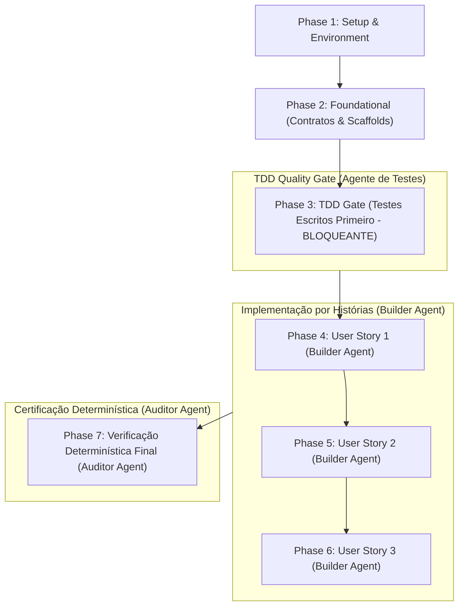

# Tasks: Adoção Local de Ferramentas ArtCraft para Autoria de Ativos

**Input**: Design documents from `specs/003-artcraft-local-authoring/` (`spec.md`, `plan.md`, `data-model.md`, `contracts/sidecar.schema.json`, `quickstart.md`, `research.md`, `.specify/memory/constitution.md`)

**Prerequisites**: `specs/003-artcraft-local-authoring/plan.md`, `spec.md`, `research.md`, `data-model.md`, `contracts/sidecar.schema.json`, `quickstart.md`, `.specify/memory/constitution.md`

**Organization**: Tasks are strictly grouped by user story (US1, US2, US3) to enable independent implementation, testing, and delivery.

## Execution Rules & Governance

0. **Scaffold/Template Primeiro**: Todo código que pode ser gerado por template/scaffold (contrato JSON Schema, stubs de módulos, arquivos de teste) DEVE ser gerado ANTES de qualquer escrita manual. As tarefas de scaffold rodam nas Fases 1–2; a implementação manual roda nas Fases 4–6.
1. **TDD Obrigatório (Fase de Testes Inicial)**: As tarefas de testes (unitários Node + integração Node + E2E Playwright) são as primeiras da suíte, BLOQUEANDO integralmente todas as tarefas de implementação subsequentes até que todos os testes estejam redigidos e falhem comprovadamente (*Red Phase*). Usar testes baseados em propriedades (property-based) sempre que aplicável, testando invariantes.
2. **Separação Estrita de Agentes / Modelos**:
   - **Agente de Testes (TDD Author)**: Responsável exclusivamente pela escrita dos testes na Fase 3.
   - **Agente de Implementação (Builder)**: Agente DISTINTO do autor dos testes, atuando nas Fases 4–6, focado apenas em fazer os testes passarem sem alterar asserções ou relaxar contratos.
   - **Agente de Verificação Determinística (Auditor/Verifier)**: Executa as tarefas de verificação (Fase 7), sendo o ÚNICO que atesta o sucesso das implementações. O agente de implementação está proibido de declarar conclusão por conta própria.
3. **Paralelismo e Ondas de Subagentes**: Tarefas que podem ser realizadas em paralelo (arquivos distintos, sem dependência mútua) estão explicitamente marcadas com `[P]`. Executar via subagent-driven development em ondas; tarefas que compartilham contexto devem reutilizar o mesmo subagente.
4. **Verificação Determinística por Tarefa**: Cada bloco de implementação possui verificação determinística estrita e executável via script/portão (`npm run test:unit`, `npm run build`, `npm run report`, `npx playwright test ...`).
5. **Hook Determinístico de Commit**: Sempre que a edição de um arquivo termina, criar um commit atômico convencional com o resumo detalhado das edições (`<tipo>(<escopo>): <resumo>`). Um commit por tarefa; nunca agrupar múltiplas tarefas em um commit; nunca usar `--no-verify`.
6. **Scaffolds antecipados (early scaffolds)**: um scaffold marcado `[x]` fora de ordem (ex.: T011c) é permitido quando explicitamente aprovado e não relaxa contratos; não desbloqueia siblings da mesma fase, que permanecem `[ ]` até sua própria conclusão.

## Format: `- [ ] [TaskID] [P?] [Story?] Description with file path`

- **[TaskID]**: Identificador da tarefa (ex.: T007, T005a, T039a).
- **[P]**: Pode rodar em paralelo (arquivos diferentes, sem dependências concorrentes).
- **[Story]**: Rótulo da história do usuário (`[US1]`, `[US2]`, `[US3]`). Tarefas de setup, scaffolds, TDD gate e polish/verificação geral não usam rótulo de história.
- Caminhos de arquivo exatos fornecidos em todas as tarefas.
- **[ID com sufixo]** (ex.: T005a): usado para inserções pontuais em uma fase já numerada, preservando a ordem dos IDs existentes. Apenas para adições; nunca para renumeração retroativa.

Nota de terminologia: headings em PT usam 'quadro'; identificadores, caminhos e código usam `frame` (canônico per Terminologia do spec.md).
---

## Phase 1: Setup & Environment Preparation

**Purpose**: Infraestrutura estática, diretórios e validação de ferramentas para a feature `003-artcraft-local-authoring`.

**Escopo**: Apenas `media-src/frames/`. A produção de masters de áudio (WAV) é follow-up fora deste feature (ver FR-001/Non-Goals).

**Non-Goal (explícito)**: masters de áudio (WAV) estão fora do escopo desta feature (follow-up); apenas os quadros frame-01…frame-04 são entregues (FR-001, FR-014, SC-001).
- [ ] T001 [P] Validar o baseline executando `npm run preflight && npm run validate && npm run test:unit && npm run build:images && npm run build` a partir da raiz do repositório (escopo do baseline: portões de build/unit; e2e/perf ficam para T043/T044)
- [ ] T002 [P] Criar o diretório de scratch `build/` na raiz do repositório e verificar que está registrado em `.gitignore` (já presente; nunca em `assets/`, `dist/` ou `src/`)
- [ ] T003 [P] Criar o diretório `marketing/` na raiz (fora de `assets/` e de `media-src/frames|audio`) com um `README.md` explicando que não é processado por `build:images`/`build`/`validate` nem contado em `budget.json`. A verificação de licença MIT/trademark é consolidada em T039 (não duplicar aqui) (FR-005/FR-001)
- [ ] T004 [P] Criar o esqueleto de `docs/authoring.md` com as seções: fluxo de autoria, ferramentas, versão "testada-com", rastreabilidade (trailers + sidecar), licenciamento MIT e arte promocional
- [ ] T005 [P] [OPCIONAL] Adicionar o script `clean:assets` em `package.json` como passo de limpeza separado e documentado (não parte de `build:images`; não requerido por FR/SC — manutenção opcional; pode ser omitido sem impacto) (já opcional; nenhum FR/SC depende deste script).

- [ ] T005a [P] Medir e registrar o baseline atual de orçamento (frame mais pesado e total) e LCP antes da integração, usando `npm run report` e Lighthouse; registrar os valores em `docs/authoring.md`
- [ ] T005b [P] Verificar que nenhuma imagem OG/social precisa ser copiada para `dist/` neste feature (fora de escopo per clarificação batch 2); documentar a decisão em `docs/authoring.md`. Nenhuma alteração em `scripts/build.mjs` (U2/I1).

**Checkpoint**: Setup estático pronto.

---

## Phase 2: Foundational (Contratos & Scaffolds — Bloqueantes)

**⚠️ CRITICAL**: Nenhuma implementação manual pode iniciar antes da conclusão dos scaffolds e do portão TDD.

- [ ] T006 [P] Gerar/validar o contrato `specs/003-artcraft-local-authoring/contracts/sidecar.schema.json` (JSON Schema draft 2020-12; `additionalProperties: false`; `sha256` com `^[0-9a-f]{64}$`; timestamps UTC `Z|+00:00`; enums `oversight` = `human_authored|human_assisted|human_reviewed` e `decision` = `approve|reject`)
- [ ] T007 [P] Scaffold do módulo `scripts/svg-sanitize.mjs` (stub com assinaturas exportadas: `sanitizeSvg`, `isSafeSvgReference`, `SVG_DOS_CAPS`)
- [ ] T008 [P] Scaffold do módulo `scripts/sidecar.mjs` (stub: `verifySidecar`, `findOrphanSidecars`, `validateSidecarSchema`)
- [ ] T009 [P] Scaffold do módulo `scripts/delivery-fidelity.mjs` (stub: `measureFidelity`, `assertFidelity`, `FIDELITY_THRESHOLDS`)
- [ ] T010 [P] Scaffold do módulo `scripts/atomic-write.mjs` (stub: `writeFileAtomic`)
- [ ] T011 [P] Scaffold do módulo `scripts/ci-trailers.mjs` (stub: `validateCommitTrailers`, `validateReviewBlock`)

- [ ] T011a [P] Criar helper de teste baseado em propriedades (PRNG determinístico semeado, sem dependência nova) em `tests/unit/property-helpers.mjs` (exportando `createPrng(seed)`, `randomSvgGrammar(prng)`, `randomSidecarDoc(prng)`) para reuso pelos testes de invariante (FR-002/plan Testing; U1).

- [ ] T011b [P] [GATE MANUAL] Validar o vocabulário SVG (allow-list em `plan.md`) contra um export real do vectorcraft antes de implementar o gate; **bloqueante para T012 e T023**. Critério de saída: (a) export real passa sem rejeição indevida, ou (b) allow-list ajustada com diff registrado em `docs/authoring.md` (seção "SVG allow-list validation"). Registrar resultado (pass/fail + diff) e a versão "testada-com" do app. Fallback: se o export real não estiver disponível, usar um fixture sintético derivado de um export registrado em `tests/fixtures/` e registrar a justificativa em `docs/authoring.md` (seção 'SVG allow-list validation'); a tarefa não pode ser silenciosamente pulada. **Risco rastreado**: o fallback sintético pode não cobrir o vocabulário real do vectorcraft; se utilizado, registrar a lacuna como risco em T045 (obrigatório, não opcional). Bloqueio: estrito para T023 (implementação); T012 (testes) pode iniciar com o vocabulário draft de plan.md, refinado após T011b. A tarefa não pode ser silenciosamente pulada.
- [x] T011c [P] Consolidar `isSafeLocalReference` em `src/scripts/safe-reference.js` (fonte canônica única) e reexportar em `src/scripts/story-loader.js` e `scripts/build.mjs`; `scripts/sidecar.mjs` (T008/T024) importa da fonte canônica (D1). Evita drift entre validador de manifesto, pipeline e portão de sidecar. Cobertura via testes existentes de story-loader/build; nenhum teste dedicado requerido. **Approved early scaffold (safe-reference consolidation only); SVG allow-list validation remains owned by T011b.** Aplicado em 2026-10-18; `npm run test:unit` verde (139/139). (migrado de T022a; U3/A4).

**Checkpoint**: Contratos e scaffolds prontos.

---

## Phase 3: TDD Gate — Testes Escritos Antecipadamente (BLOQUEANTE) ⚠️

> **REGRA FUNDAMENTAL DE TDD**:
> - Esta fase DEVE ser executada integralmente pelo **Agente de Testes (TDD Author)**.
> - Todos os testes abaixo DEVEM ser implementados e commitados ANTES de qualquer alteração de código produtivo.
> - Todos os testes DEVEM FALHAR (*Red Phase*) antes de desbloquear as Fases 4–6.
> - NENHUMA tarefa de implementação pode ser iniciada até todas as tarefas de teste da Fase 3 (T011a, T012, T013, T014, T015, T015b, T016, T017, T018, T019, T020, T021, T022, T022b, T022c) estarem concluídas e falhando nos testes.

> **Escopo dos testes (D2)**: Os pares `svg-sanitize.test.js`/`artcraft-svg-gate.test.js`, `sidecar.test.js`/`artcraft-sidecar.test.js` e `delivery-fidelity.test.js`/`artcraft-fidelity.test.js` cobrem, respectivamente, o nível de **unidade do módulo** e o nível de **integração do fluxo de build**. Não duplicar asserções entre os dois níveis; cada invariante vive em apenas um dos dois. **Propriedade de cada invariante deve ser anotada no cabeçalho do arquivo de teste correspondente** (ex.: `// OWNS: SVG allow-list reject vectors`) antes da implementação, para evitar duplicação acidental.

> Anotação property-based por tarefa: T012/T013/T014/T022c = sim (invariantes); T015/T016/T017/T018/T019/T020/T021/T022/T022b = não (cenários determinísticos/exemplos).
### Testes de Unidade (Node Native Test Runner) — com property-based onde aplicável

- [ ] T012 [P] Escrever testes unitários para `scripts/svg-sanitize.mjs` em `tests/unit/svg-sanitize.test.js`:
  - Invariante: vocabulário permitido (vectorcraft) passa sem lançar erro
  - Invariante: todo vetor perigoso (`<script>`, handlers `on*`, `foreignObject`, `href`/`xlink:href` externos, todo DOCTYPE, URIs `data:`, SMIL `animate|set|animateMotion|animateTransform|discard`, elementos DOMPurify-forbidden, vetores CSS `url()|@import|image-set()|expression()|-moz-binding|behavior:`) lança erro nomeando o vetor
  - Invariante: referência interna `url(#…)` permitida; referências absolutas, protocol-relative, de caminho relativo e `data:` rejeitadas
  - Caps de DoS mensuráveis: arquivo > 1 MB (1 048 576 B), elementos > 10 000, profundidade > 100, atributos/elemento > 256 → lança erro
  - Caps de expansão de referência: `<use>`/`<pattern>` com mais de 100 000 referências expandidas ou profundidade > 20, ou ciclos de referência → lança erro (plan.md, SVG allow-list)
  - Property-based: gerar SVGs aleatórios determinísticos (PRNG com seed fixa) a partir de uma gramática e assertar que o veredito do gate corresponde a um oráculo (allow-list/reject-list)
  - (Confirmar que os testes em `tests/unit/svg-sanitize.test.js` falham)

- [ ] T013 [P] Escrever testes unitários para `scripts/sidecar.mjs` em `tests/unit/sidecar.test.js`:
  - sidecar válido passa; digest mismatch lança; `subject.name` stale lança; JSON inválido lança; campo desconhecido lança (strict); `sha256` não-hex-64 lança; timestamp não-UTC lança; `inputs[].uri` inseguro lança; sidecar ausente é no-op; sidecar órfão lança; dois masters com o mesmo stem (extensões diferentes) no mesmo diretório lançam `invalid-master-stem-collision` (FR-008)
  - Property-based: gerar docs de sidecar válidos/inválidos e assertar o veredito contra o contrato JSON Schema
  - (Confirmar que os testes em `tests/unit/sidecar.test.js` falham)

- [ ] T014 [P] Escrever testes unitários para `scripts/delivery-fidelity.mjs` em `tests/unit/delivery-fidelity.test.js`:
  - imagens idênticas → SSIM ≈ 1.0 e PSNR alto; imagem corrompida → SSIM baixo; `assertFidelity` lança abaixo do threshold standard e apenas avisa abaixo do threshold light
  - Property-based: gerar pares (variante, referência) com degradação controlada e assertar a monotonicidade SSIM/PSNR
  - (Confirmar que os testes em `tests/unit/delivery-fidelity.test.js` falham)

- [ ] T015 [P] Escrever testes unitários para os gates de `scripts/build-images.mjs` em `tests/unit/build-images-gates.test.js`:
  - master sob `media-src/` com lado > 1200 px rejeitado (`invalid-master-geometry`); master sob `tests/fixtures/` aceito até o teto rígido ≤ 2560 px (detecção por raiz de caminho, não por sidecar); sem upscaling (`withoutEnlargement: true`)
  - pisos de qualidade: standard AVIF ≥30/WebP ≥45/JPEG ≥45 e light AVIF ≥20/WebP ≥30/JPEG ≥30 lançam erro nomeando o frame
  - srcset do manifesto lista apenas larguras que o master preenche (320/640/960/1200 para masters de 1200 px)
  - smoke de rasterização SVG por sharp (FR-006): master SVG válido gera variantes raster sem erro
  - (Confirmar que os testes em `tests/unit/build-images-gates.test.js` falham)

- [ ] T015b [P] Atualizar os testes existentes afetados pelos novos portões (`tests/unit/delivery.test.js`, `tests/unit/integrity-media.test.js`, `tests/unit/media-generation.test.js`) para refletir sanitização SVG, digest de sidecar e Tier B, **sem relaxar asserções** nem alterar contratos (M3).

- [ ] T016 [P] Escrever testes unitários para `scripts/atomic-write.mjs` em `tests/unit/atomic-write.test.js` (invariantes são property-testáveis; variante property-based opcional):
  - arquivo temporário criado no mesmo diretório do alvo; `rename()` atômico; interrupção simulada por injeção de falha (throw no meio da escrita) não deixa saída parcial; reexecução segura
  - (Confirmar que os testes em `tests/unit/atomic-write.test.js` falham)

### Testes de Integração (Node) — fluxo de build em diretório temporário

- [ ] T017 [P] Escrever teste de integração do fluxo de autoria em `tests/unit/artcraft-authoring.test.js`:
  - criar um master em um `media-src/frames/` temporário → `buildImages()` gera variantes em `assets/` → orçamento respeitado → nenhum asset não referenciado
  - (Confirmar que o teste em `tests/unit/artcraft-authoring.test.js` falha)

- [ ] T018 [P] Escrever teste de integração da rejeição SVG em `tests/unit/artcraft-svg-gate.test.js`:
  - master SVG perigoso → `buildImages()` lança erro nomeando o frame; nenhuma variante gerada
  - incluindo caps de expansão de referência e ciclos
  - (Confirmar que o teste em `tests/unit/artcraft-svg-gate.test.js` falha)

- [ ] T019 [P] Escrever teste de integração de digest/sidecar órfão em `tests/unit/artcraft-sidecar.test.js`:
  - sidecar com digest errado → lança; sidecar órfão → lança (`orphan-sidecar`); sidecar correto → passa; sidecar localizado em `src/` ou `assets/` (fora de `media-src/`/`marketing/`) não é honrado (placement fail-closed: um `.json` em `src/` seria publicado por `copyPublishableFiles`, e em `assets/` falha `findUnreferencedAssets`; ver FR-013)
  - (Confirmar que o teste em `tests/unit/artcraft-sidecar.test.js` falha)

- [ ] T020 [P] Escrever teste de integração do portão Tier B em `tests/unit/artcraft-fidelity.test.js`:
  - variante standard abaixo do SSIM → lança; variante light abaixo do SSIM → apenas avisa; referência PNG gravada sob `build/`
  - (Confirmar que o teste em `tests/unit/artcraft-fidelity.test.js` falha)

### Testes End-to-End (Playwright)

- [ ] T021 [P] Escrever teste E2E de cobertura DPR>1 em `tests/e2e/artcraft-dpr.spec.js`:
  - emular `deviceScaleFactor: 2`; verificar que o `srcset` do manifesto não contém entradas mortas e que o quadro renderiza sem estado de imagem quebrada
  - critério mensurável: `naturalWidth` do elemento ≤ 1200 (teto intrínseco do master); candidato do `srcset` selecionado ≤ 1200w; nenhum estado de imagem quebrada; upscaling pelo navegador em DPR≥2 é esperado e não é falha (não reprova)
  - (Confirmar que o teste em `tests/e2e/artcraft-dpr.spec.js` falha)

- [ ] T022 [P] Escrever teste de unidade (Node native runner) de enforcement de trailers/review em `tests/unit/artcraft-trailers.test.js`, usando uma **fixture de repositório git temporário** (preferido) — ou mock de `execSync`/`git log` apenas se o temp repo for inviável — para simular commits que tocam `media-src/`:
  - commit que toca `media-src/` sem `Authored-With`, `Reviewed-By` ou bloco `review` → o validador lança (fail-closed)
  - commit com trailers completos + bloco `review` (`decision: approve`) → passa
  - trailer `Authored-With` deve concordar com `provenance.tool` + `provenance.toolVersion` do sidecar (normalização: colapsar espaços e remover `v` inicial) → mismatch lança (FR-008)
  - commit que deleta um master exige os trailers e a remoção do sidecar extension-swap no mesmo commit; renames são tratados como delete+add (FR-013)
  - invocação local permitida; o passo permanece fora da cadeia `npm run ci` (FR-013 (e))
  - (Confirmar que o teste em `tests/unit/artcraft-trailers.test.js` falha)

- [ ] T022b [P] Escrever teste de unidade `tests/unit/artcraft-absence.test.js` verificando ausência de binários ArtCraft em `git ls-files`, `PATH` e `node_modules` (fail-closed; SC-005/FR-013 (g)) — migrado da antiga T031a para respeitar o portão TDD (U1). (Confirmar que o teste falha)

- [ ] T022c [P] Escrever teste de unidade `tests/unit/story-metadata.test.js` validando a regra F20: (a) `alt ≠ description`; (b) `alt ≤ 125 chars`; (c) `description` reproduz todo o lettering visível; (d) `durationMs ≥ minMs` onde `minMs = 500 + (words/150)·60000 + 1000` clampado a [500, 30000], com `words` = número de palavras do `description`; (e) `durationMs` recomputado apenas quando a permanência mínima muda >10% ou cruza o piso de 500 ms. (Confirmar que o teste falha)
**Checkpoint TDD**: 100% dos testes redigidos (incluindo `story-metadata.test.js`, T022c) e em estado FALHO comprovado (*Red Phase*). Implementação liberada para o **Agente de Implementação (Builder)**.

---

## Phase 4: User Story 1 - Autorar um Quadro com Ferramentas ArtCraft (Priority: P1) 🎯 MVP

**Goal**: Permitir ao autor/mantenedor criar um quadro nas ferramentas ArtCraft, exportá-lo para `media-src/frames/` e tê-lo convertido pelo pipeline existente em variantes AVIF/WebP/JPEG (com srcset), com os três portões de build-time ativos, sem alterar o produto entregue ao leitor.

**Independent Test**: Autorar um quadro em vectorcraft, exportar para `media-src/frames/frame-XX.svg`, rodar `npm run validate && npm run build:images && npm run build` e verificar que o quadro aparece em `assets/` e no manifesto sem violar orçamentos nem referências externas.

> **Executor**: Agente de Implementação (Builder - distinto do autor dos testes).

### Implementation Tasks for User Story 1

- [ ] T023 [US1] Implementar `scripts/svg-sanitize.mjs` conforme o contrato do stub (reject-list piso + allow-list fail-closed sobre o vocabulário vectorcraft, caps de DoS, `url(#…)` permitido, referências externas/`data:` rejeitadas) — depende de T011b

- [ ] T024 [P] [US1] Implementar `scripts/sidecar.mjs` conforme o contrato do stub (validação strict do schema, recomputação e comparação de SHA-256, staleness de `subject.name`, detecção de sidecar órfão, no-op quando ausente)

- [ ] T025 [P] [US1] Implementar `scripts/delivery-fidelity.mjs` conforme o contrato do stub (medição SSIM/PSNR via ffmpeg nativo, referência PNG lossless do master por largura sob `build/`, thresholds standard/light)

- [ ] T026 [P] [US1] Implementar `scripts/atomic-write.mjs` conforme o contrato do stub (arquivo temporário no mesmo diretório + `rename()`; sem `os.tmpdir()`)

- [ ] T027 [US1] Integrar os três portões + pisos de qualidade + geometria de canvas 1200×800 + escrita atômica em `scripts/build-images.mjs` (portão SVG antes de `sourceWidth()`/`encodeImage()`; digest por master; Tier B após `ensureImage()`; pisos standard/light lançando erro nomeando o frame; masters > 1200 px rejeitados com `invalid-master-geometry`)

- [ ] T027a [US1] Adicionar `QUALITY_FLOORS` explícitos em `scripts/build-images.mjs` (standard AVIF≥30/WebP≥45/JPEG≥45; light AVIF≥20/WebP≥30/JPEG≥30) lançando erro nomeando o frame em vez de degradar silenciosamente (FR-012/FR-011; U1-migrated).
- [ ] T027b [US1] Rejeitar masters sob `media-src/` com lado maior > 1200 px via throw `invalid-master-geometry` (detecção por raiz de caminho); masters sob `tests/fixtures/` aceitos até o teto rígido ≤ 2560 px; manter `withoutEnlargement` (FR-012).
- [ ] T028 [US1] [ENTREGÁVEL DE AUTORIA HUMANA] Autorar os 4 quadros em `media-src/frames/frame-01.<ext>`…`frame-04.<ext>` (ext ∈ {svg,png,jpg} per FR-001; 1200×800, 3:2) com sidecars `media-src/frames/frame-0X.json` contendo `subject.digest.sha256` correto e bloco `review` com `decision: approve`. A validação agente cobre sidecars/trailers (T019/T029). **Tier A checklist (por master)**: dimensões exatas 1200×800; sem upscaling além do master; `review.notes` (no sidecar) e o commit documentam tamanho, formato, impressão qualitativa e verificação de paleta/intervalo tonal; `decision: approve`.
- [ ] T028a [US1] Atualizar `src/data/story.json` conforme a regra F20 (staleness): atualizar `alt` e `description` no mesmo change que modifica a imagem; recomputar `durationMs` apenas se a permanência mínima mudar >10% ou cruzar o piso de 500 ms; validar com `npm run validate` (FR-007/FR-009).

- [ ] T029 [US1] Registrar os trailers `Authored-With: vectorcraft-cli <versão>` e `Reviewed-By: <nome>` nos commits dos masters em `media-src/frames/`

### Deterministic Verification for User Story 1

- [ ] T030 [US1] **Evidência determinística de comando (executada pelo Builder; atestação final em T045)**: Executar `npm run test:unit && npm run validate && npm run build:images && npm run build && npm run report` (sequência canônica de SC-001 é `validate && build:images && build`; `test:unit` e `report` são verificação suplementar e podem rodar antes/ depois) (I1)
  - Critério objetivo de sucesso: 100% dos testes unitários passam; build exit 0; nenhum asset não referenciado; orçamentos respeitados; 4/4 quadros gerados; nenhum fixture sintético permanece em `media-src/frames/` (verificado por: diretório contém exatamente `frame-01..frame-04` com extensões aceitas e sidecars correspondentes; arquivos em `tests/fixtures/` permanecem intocados); cada sidecar `review.notes` documenta paleta/intervalo tonal via template (tamanho, formato, impressão qualitativa, paleta) (FR-007/FR-014).
  - Regra F20 aplicada ao `story.json` final (alt≠description, alt≤125 chars, description reproduz lettering, durationMs≥minMs, recomputação apenas >10% ou piso de 500 ms) — verificado por T022c.

**Checkpoint**: User Story 1 funcional e verificada de forma determinística.

---

## Phase 5: User Story 2 - Preservar o Pipeline e os Orçamentos (Priority: P1)

**Goal**: Garantir que a adoção das ferramentas ArtCraft não altere o pipeline de build, o player, os orçamentos nem a matriz de testes, e que `npm run ci` continue executável sem a suíte instalada.

**Independent Test**: Rodar `npm run ci` completo após integrar um master autoral e verificar que todos os portões passam sem regressão; confirmar que nenhum binário ArtCraft é necessário.

> **Executor**: Agente de Implementação (Builder - distinto do autor dos testes).

### Implementation & Verification Tasks for User Story 2

- [ ] T031 [P] [US2] [GATE MANUAL] Documentação consolidada em T031a (não duplicar): referenciar `node --test tests/unit/artcraft-absence.test.js` e seus resultados; sem comando separado (FR-013 (g)/SC-005; U4).
- [ ] T031a [P] [US2] Executar `node --test tests/unit/artcraft-absence.test.js` (redigido em **T022b**, portão TDD) e confirmar passagem; verificar ausência de binários ArtCraft em `git ls-files`, `PATH` e `node_modules` (fail-closed; SC-005/FR-013 (g)) (U1)

- [ ] T032 [P] [US2] Verificar que `npm run ci` executa e passa sem a suíte ArtCraft instalada no PATH

- [ ] T033 [P] [US2] Verificar orçamentos via `npm run report`: por frame ≤ 300 000 B (soma do maior AVIF + maior WebP + maior JPEG) e total ≤ 30 000 000 B; asserção de que `marketing/` não é referenciado pelo manifesto nem contado em `budget.json` (G3). Incluir asserção automatizada em `tests/unit/build-images-gates.test.js` (arquivo único, não criar teste dedicado) verificando que `marketing/` não é referenciado pelo manifesto nem contado em `budget.json`.
- [ ] T034 [P] [US2] Verificar a cobertura DPR>1 executando `npx playwright test tests/e2e/artcraft-dpr.spec.js --project=desktop-chromium`

### Deterministic Verification for User Story 2

- [ ] T035 [US2] **Evidência determinística de comando (executada pelo Builder; atestação final em T045)**: Executar `npm run ci` completo (preflight, validate, test:unit, build:images, build, test:e2e, test:perf) e confirmar exit 0 sem regressão (verificação incremental; a certificação final determinística é T044).
  - Critério objetivo de sucesso: todos os portões passam; nenhum binário ArtCraft é invocado.

**Checkpoint**: User Stories 1 e 2 funcionais e verificadas de forma determinística.

---

## Phase 6: User Story 3 - Documentar e Rastrear a Autoria (Priority: P2)

**Goal**: Prover um fluxo documentado de autoria com rastreabilidade da ferramenta e versão usadas, e enforcement fail-closed de trailers/bloco `review` para commits que tocam `media-src/`.

**Independent Test**: Verificar que existe `docs/authoring.md` com o fluxo passo-a-passo e que o passo de CI rejeita commits que tocam `media-src/` sem `Authored-With`/`Reviewed-By`/bloco `review`.

> **Executor**: Agente de Implementação (Builder - distinto do autor dos testes).

### Implementation Tasks for User Story 3

- [ ] T036 [P] [US3] Implementar `scripts/ci-trailers.mjs` conforme o contrato do stub (validação fail-closed de trailers `Authored-With`/`Reviewed-By` e do bloco `review` com `decision: approve` para commits que tocam `media-src/`; detecção de sidecar órfão delegada ao build gate `build:images` — não revalidar aqui; forward-only; `fetch-depth: 0`)

- [ ] T037 [US3] Modificar o step de checkout do job **`gate`** em `.github/workflows/ci.yml` para `fetch-depth: 0` (os jobs `webkit-layout-gate` e `macos-webkit-compositor` permanecem em depth 1) e adicionar, nesse mesmo job, o passo executando `node scripts/ci-trailers.mjs` (nunca em `npm run ci`); validar o YAML resultante com `actionlint` (pinado no workflow ou `go install github.com/rhysd/actionlint/cmd/actionlint@v1.7.7`) ou, na ausência, parser YAML Node (`js-yaml`) como fallback documentado em `docs/authoring.md` (U5). `actionlint` não é adicionado a `package.json` (sem nova dependência). **Nota (M8)**: PRs que tocam `media-src/` sem sidecar (ou sem `review.decision: approve`) falham no CI (fail-closed) — comportamento intencional; build isolado permanece no-op quando o sidecar está ausente.

- [ ] T037a [P] [US3] [GATE MANUAL] Verificar pré-requisito de host `librsvg` (necessário para rasterização SVG por sharp): documentar em `docs/authoring.md` (T038) e adicionar verificação obrigatória ao preflight via `pkg-config --exists librsvg-2.0` (fallback: probe de decode SVG via sharp) (U2/CC2)
- [ ] T038 [US3] Escrever `docs/authoring.md` com: fluxo passo-a-passo (criar no app → exportar → `media-src/` → pipeline → validar), ferramentas e versão "testada-com" (resultante de T011b/T039, com data de validação), rastreabilidade (trailers + sidecar), licenciamento MIT (preservar copyright/license; nunca redistribuir trademark), pré-requisito de host `librsvg` (T037a), arte promocional em `marketing/`, pré-requisito opcional `nektos/act` para simulação do passo de CI (T040a), baseline Lighthouse (T005a) e seção "Autoria de áudio (documentada; follow-up)" descrevendo masters WAV de qualquer DAW estável, alvo −14/−16 LUFS, true peak ≤ −1 dBTP (A4). Dependências: T011b (vocabulário/versão testada-com) e T039 (licença/ASSETS.md); registrar resultados antes de fechar.
- [ ] T039 [P] [US3] [GATE MANUAL] Verificar a licença MIT adotada, a ausência de redistribuição de trademark ArtCraft e revisar o `ASSETS.md` de **cada app ArtCraft** (pré-requisito: obter `ASSETS.md` da instalação local de cada app; arquivo externo da suíte, não versionado aqui). Registrar checksum (SHA-256) e versão "testada-com" de cada `ASSETS.md` em `docs/authoring.md` (A2/A4); registrar resultado (pass/fail) e evidência em T045 (FR-005; T077-migrated; A5; I6). Checklist documentado: (1) obter `ASSETS.md` de cada app em sua instalação local; (2) verificar opção MIT adotada; (3) verificar ausência de redistribuição de trademark; (4) registrar SHA-256 e versão 'testada-com' de cada `ASSETS.md` em `docs/authoring.md` (seção 'Licenciamento'). Nenhum script automatizado é requerido; a verificação é manual e registrada em T045. Fallback: se `ASSETS.md` não estiver disponível na instalação local, registrar a indisponibilidade e a justificativa em `docs/authoring.md` e em T045 (risco rastreado); a tarefa não pode ser silenciosamente pulada.
- [ ] T039a [P] Verificar que os Non-Goals (FR-010) permanecem respeitados: nenhum binário ArtCraft no repo/CI, nenhum filmcraft/effectcraft no runtime, nenhum cambio de schema/player

### Deterministic Verification for User Story 3

- [ ] T040 [US3] **Evidência determinística de comando (executada pelo Builder; atestação final em T045)**: Executar `node scripts/ci-trailers.mjs` contra fixtures (commit com trailers completos passa; commit sem trailers falha) e `npm run test:unit` — invocação local permitida; o passo permanece fora da cadeia `npm run ci` (FR-013 (e))
  - Critério objetivo de sucesso: validador fail-closed comprovado; testes unitários passam.

- [ ] T040a [P] (opcional) Verificar o passo de CI com `act` (nektos/act) ou equivalente: **pré-requisito — instalar `nektos/act` previamente** (`curl -s https://raw.githubusercontent.com/nektos/act/master/install.sh | sudo bash` ou `brew install act`; versão mínima documentada em `docs/authoring.md`). Simular um commit que toca `media-src/` sem trailers e confirmar que o step falha; simular um commit com trailers completos e confirmar que passa. Pode ser omitida se a ferramenta não estiver disponível, com justificativa registrada (U4).

**Checkpoint**: Todas as histórias de usuário (US1, US2, US3) implementadas e verificadas.

---

## Phase 7: Polish, Quality Gates & Deterministic Final Certification

**Purpose**: Verificação orçamentária estrita, testes de regressão de toda a esteira do projeto e certificação final independente.

> **REGRA FUNDAMENTAL DE VERIFICAÇÃO**:
> - Esta fase DEVE ser executada pelo **Agente de Verificação Determinística (Auditor/Verifier)**.
> - O agente de implementação NÃO PODE atestar conclusão por opinião ou estimativa.
> - SOMENTE o sucesso cabal dos comandos determinísticos abaixo valida a conclusão da feature.

- [ ] T041 [P] Executar a suíte de testes unitários completa via `npm run test:unit` e confirmar 100% de passagem

- [ ] T042 [P] Executar `npm run build` e auditar `budget.json` (initial scene, per-frame, total, compressed code) sem violações

- [ ] T043 [P] Executar a matriz Playwright local: `npx playwright test tests/e2e/artcraft-*.spec.js tests/e2e/navigation.spec.js tests/e2e/audio.spec.js tests/e2e/reduced-motion.spec.js --project=mobile-chromium --project=desktop-chromium --project=desktop-firefox` e confirmar zero falhas

- [ ] T044 Executar a esteira completa `npm run ci` (preflight, validate, test:unit, build:images, build, test:e2e, test:perf) e confirmar exit 0

- [ ] T044a [P] Executar `npm run lhci` (Lighthouse CI) e confirmar perf ≥ 0,9, a11y ≥ 0,95, CLS < 0,1, LCP ≤ 2500 ms sem regressão (SC-006)

- [ ] T045 **Atestação Final de Sucesso**: Registrar relatório determinístico de fechamento contendo:
  - Status de aprovação de todos os portões (unit, build, e2e matrix, ci completo)
  - Orçamentos medidos (per-frame e total) vs `budget.json` e vs baseline registrado em T005a
  - Confirmação de 4/4 quadros autorais e ausência de fixtures sintéticos publicados (verificação mecânica: cada `media-src/frames/frame-0X.<ext>` possui sidecar com `review.decision: approve` e commit correspondente com trailers `Authored-With`/`Reviewed-By`; U8)
  - Confirmação de ausência de binários ArtCraft (PATH/node_modules/git ls-files) (FR-013 (g)) — automatizada por T031a
  - Confirmação de revisão Tier A (SC-007b) por master: sidecar `review` com `decision: approve` + trailer `Reviewed-By` (CG3)
  - Registro **obrigatório** da exceção documentada warn-only light vs Princípio IV, com justificativa (CC1) — ausência reprova o fechamento
  - Confirmação de pré-requisito de host `librsvg` (U2/CC2)
  - Impedir encerramento sem os logs comprobatórios de execução

---

## Dependencies & Execution Order

### Phase Dependencies

### Regras de Transição e Bloqueio

1. **Portão TDD (Fase 3)**: Bloqueia totalmente o início de qualquer implementação. Nenhuma linha de código produtivo pode ser alterada em `scripts/` antes de T011a, T012–T022, T015b, T022b, T022c estarem concluídos e falhando nos testes.
2. **Scaffold antes da escrita manual**: Nenhuma implementação manual (Fases 4–6) pode iniciar antes de T006–T011 (contratos e scaffolds).
3. **Separação de Papéis**:
   - `Agente de Testes`: Conclui Fase 3.
   - `Agente de Implementação`: Conclui Fases 4, 5 e 6 fazendo os testes passarem sem reescrever ou amolecer asserções.
   - `Agente de Verificação`: Executa Fase 7 emitindo o atestado final baseado exclusivamente em evidência de saída de comando.
4. **Hook de Commit**: Cada tarefa que edita arquivos termina com um commit atômico convencional detalhado; um commit por tarefa.

---

## Parallel Execution Opportunities

- **Scaffolds (Fase 2)**: T006, T007, T008, T009, T010 e T011 podem rodar em paralelo (arquivos/contratos distintos) — **Onda 1**.
- **Testes TDD (Fase 3)**: T012–T022 podem rodar em paralelo (arquivos de teste separados) — **Onda 2**; cada subagente escreve um arquivo de teste.
- **Implementação US1 (Fase 4)**: T023 (`svg-sanitize.mjs`), T024 (`sidecar.mjs`), T025 (`delivery-fidelity.mjs`) e T026 (`atomic-write.mjs`) podem rodar em paralelo — **Onda 3**; a integração (T027) e a autoria (T028) dependem das quatro.
- **Verificação Final (Fase 7)**: T041 (`test:unit`), T042 (`build`) e T043 (matriz Playwright) podem ser disparados em paralelo — **Onda 4**.

### Atribuição de Subagentes por Onda (contexto compartilhado)

- **Onda 1** (scaffolds): um subagente para contratos (T006) e um subagente para stubs de módulos (T007–T011).
- **Onda 2** (testes): subagentes distintos por arquivo de teste; o subagente que escrever `svg-sanitize.test.js` (T012) reutiliza o contexto para `svg-sanitize.mjs`.
- **Onda 3** (implementação): um subagente por módulo (T023–T026); o subagente de `build-images.mjs` (T027) reutiliza o contexto de integração.
- **Onda 4** (verificação): subagentes distintos por portão; o **Agente de Verificação** consolida o atestado (T045).

---

## Implementation Strategy & MVP

1. **Passo 1 (Scaffold)**: Gerar contratos e stubs (T006–T011). Nenhuma escrita manual antes disso.
2. **Passo 2 (TDD First)**: Agente de Testes redige todos os testes unitários, de integração e E2E (T012–T022). Executa as suítes e confirma o status **RED** (falhas esperadas).
3. **Passo 3 (MVP Delivery - User Story 1)**: Agente de Implementação implementa os quatro módulos (T023–T026), integra em `build-images.mjs` (T027) e autoriza os 4 quadros (T028–T029). Executa T030 e valida o MVP.
4. **Passo 4 (Continuity - User Story 2)**: Verifica ausência de dependências novas, `npm run ci` sem ArtCraft, orçamentos e DPR>1 (T031–T034). Executa T035.
5. **Passo 5 (Perfection - User Story 3)**: Implementa o validador de trailers (T036), o passo de CI (T037), a documentação (T038) e a verificação de licença (T039). Executa T040.
6. **Passo 6 (Gate Check - Fase 7)**: Agente de Verificação roda o gate determinístico (`npm run test:unit`, `npm run build`, matriz Playwright, `npm run ci`). Apenas evidências com código de saída 0 validam o fechamento (T041–T045).
