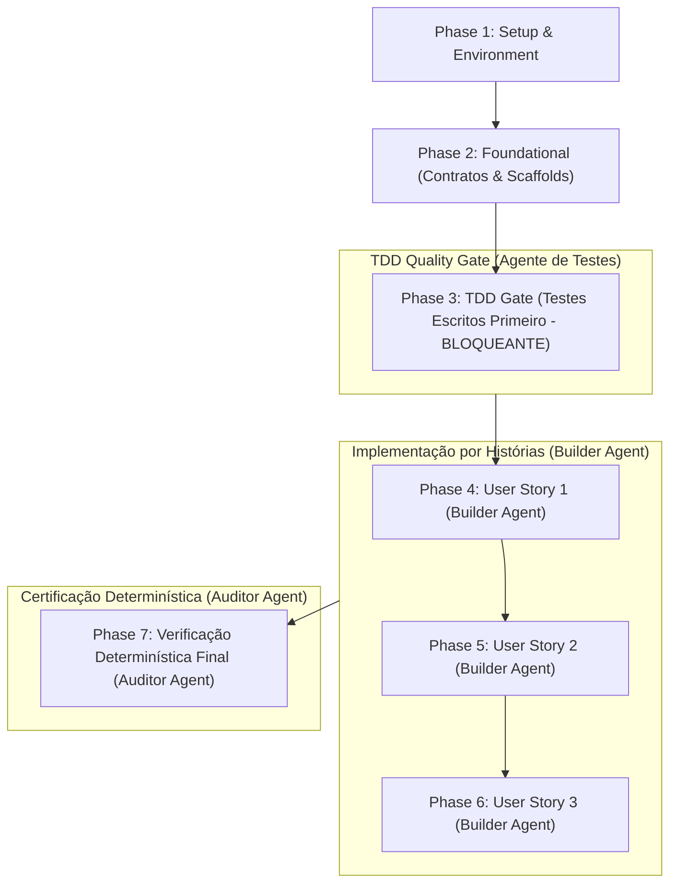

# Tasks: Adoção Local de Ferramentas ArtCraft para Autoria de Ativos

**Input**: Design documents from `specs/003-artcraft-local-authoring/` (`spec.md`, `plan.md`, `data-model.md`, `contracts/sidecar.schema.json`, `quickstart.md`, `research.md`, `.specify/memory/constitution.md`)

**Prerequisites**: `specs/003-artcraft-local-authoring/plan.md`, `spec.md`, `research.md`, `data-model.md`, `contracts/sidecar.schema.json`, `quickstart.md`, `.specify/memory/constitution.md`

**Organization**: Tasks are strictly grouped by user story (US1, US2, US3) to enable independent implementation, testing, and delivery.

## Execution Rules & Governance

Note: spec-kit uses phases 0–2 (scaffold, TDD gate, implementation); all execution/task references below use the implementation-phase numbering (1–7) exclusively.

0. **Scaffold/Template Primeiro**: Todo código que pode ser gerado por template/scaffold (contrato JSON Schema, stubs de módulos, arquivos de teste) DEVE ser gerado ANTES de qualquer escrita manual. As tarefas de scaffold rodam nas Fases 1–2; a implementação manual roda nas Fases 4–6. Gerar o scaffold via template/código (por ex., code action do editor/LSP) antes de escrever implementação à mão.
1. **TDD Obrigatório (Fase de Testes Inicial)**: As tarefas de testes (unitários Node + integração Node + E2E Playwright) são as primeiras da suíte, BLOQUEANDO integralmente todas as tarefas de implementação subsequentes até que todos os testes estejam redigidos e falhem comprovadamente (*Red Phase*). Usar testes baseados em propriedades (property-based) sempre que aplicável, testando invariantes.
2. **Separação Estrita de Agentes / Modelos**:
   - **Agente de Testes (TDD Author)**: Responsável exclusivamente pela escrita dos testes na Fase 3.
   - **Agente de Implementação (Builder)**: Agente DISTINTO do autor dos testes, atuando nas Fases 4–6, focado apenas em fazer os testes passarem sem alterar asserções ou relaxar contratos.
   - **Agente de Verificação Determinística (Auditor/Verifier)**: Executa as tarefas de verificação (Fase 7), sendo o ÚNICO que atesta o sucesso das implementações. O agente de implementação está proibido de declarar conclusão por conta própria.
3. **Paralelismo e Ondas de Subagentes**: Tarefas que podem ser realizadas em paralelo (arquivos distintos, sem dependência mútua) estão explicitamente marcadas com `[P]`. Executar via subagent-driven development em ondas; tarefas que compartilham contexto devem reutilizar o mesmo subagente.
4. **Verificação Determinística por Tarefa**: Cada bloco de implementação possui verificação determinística estrita e executável via script/portão (`npm run test:unit`, `npm run build`, `npm run report`, `npx playwright test ...`).
5. **Hook Determinístico de Commit**: Sempre que a edição de um arquivo termina, criar um commit atômico convencional com o resumo detalhado das edições (`<tipo>(<escopo>): <resumo>`). Um commit por tarefa; nunca agrupar múltiplas tarefas em um commit; nunca usar `--no-verify`. **Enforcement:** não há hook git versionado neste repositório; aplicar a regra manualmente (um commit atômico por tarefa). Tarefas que editam o mesmo arquivo (`docs/authoring.md`: T004/T005a/T005b/T038) devem ser commitadas em ordem. Hook `pre-commit` versionado é follow-up fora deste feature (registrado em T045).
6. **Scaffolds antecipados (early scaffolds)**: um scaffold marcado `[x]` fora de ordem (ex.: T011c) é permitido quando explicitamente aprovado e não relaxa contratos; não desbloqueia siblings da mesma fase, que permanecem `[ ]` até sua própria conclusão.

## Format: `- [ ] [TaskID] [P?] [Story?] Description with file path`

- **[TaskID]**: Identificador da tarefa (ex.: T007, T005a, T039a).
- **[P]**: Pode rodar em paralelo (arquivos diferentes, sem dependências concorrentes).
- **[Story]**: Rótulo da história do usuário (`[US1]`, `[US2]`, `[US3]`). Tarefas de setup, scaffolds, TDD gate e polish/verificação geral não usam rótulo de história.
- Caminhos de arquivo exatos fornecidos em todas as tarefas.
- **[ID com sufixo]** (ex.: T005a): usado para inserções pontuais em uma fase já numerada, preservando a ordem dos IDs existentes. Apenas para adições; nunca para renumeração retroativa.

Nota de terminologia: headings em PT usam 'quadro'; identificadores, caminhos e código usam `frame` (canônico per Terminologia do spec.md).
Nota de mapeamento: tarefas de setup/scaffold/polish/verificação (T001–T005b, T006–T011, T011a–c, T037a, T038a, T039a, T040a, T041–T045) são infraestrutura/meta e não mapeiam diretamente a um FR/SC; T027-verification-1/T027-verification-2 são sub-checks não contabilizados de T027.
---

## Phase 1: Setup & Environment Preparation

**Purpose**: Infraestrutura estática, diretórios e validação de ferramentas para a feature `003-artcraft-local-authoring`.

**Escopo**: Apenas `media-src/frames/`. A produção de masters de áudio (WAV) é follow-up fora deste feature (ver FR-001/Non-Goals).

**Non-Goal (explícito)**: masters de áudio (WAV) estão fora do escopo desta feature (follow-up); apenas os quadros frame-01…frame-04 são entregues (FR-001, FR-014, SC-001).

**Sequencing (remediação U2, 2026-10-18)**: a onda de pré-requisitos da Fase 1 deve rodar **antes** de qualquer trabalho da Fase 3: T001 (baseline `npm run preflight && validate && test:unit && build:images && build`) → T004 (esqueleto de `docs/authoring.md`) + T005a (baseline de orçamento/LCP) + T005b (decisão OG/social) em paralelo. Owner: mantenedor único. T038 (Fase 6) permanece bloqueada até T004/T005a/T005b concluírem; se não concluírem até o fim da Fase 6, aplicar o fallback documentado em T038 (placeholders + registro em T045).
- [x] T001 [P] Validar o baseline executando `npm run preflight && npm run validate && npm run test:unit && npm run build:images && npm run build` a partir da raiz do repositório (escopo do baseline: portões de build/unit; e2e/perf ficam para T043/T044) (baseline pré-mudança; preflight anterior à verificação de librsvg de T037a) (remediação A1/A4: em host Fedora o check `browser-launch` do preflight falha para WebKit — atestar o baseline no subconjunto de 3 projetos ou no runner ubuntu; os passos T015 (smoke SVG) e T023 dependem de librsvg no host, verificado apenas em T037a).
- [x] T002 [P] Criar o diretório de scratch `build/` na raiz do repositório e verificar que está registrado em `.gitignore` (já presente; nunca em `assets/`, `dist/` ou `src/`). **Comando (remediação U3)**: `mkdir -p build && grep -qx 'build/' .gitignore`. **Complemento (U2)**: garantir que `build-images.mjs` (Tier B / escrita atômica) crie `build/` via `mkdirSync(..., { recursive: true })` quando ausente, para que execuções em checkout limpo não falhem.
- [x] T003 [P] Criar o diretório `marketing/` na raiz (fora de `assets/` e de `media-src/frames|audio`) com um `README.md` explicando que não é processado por `build:images`/`build`/`validate` nem contado em `budget.json`. **Template mínimo (remediação U4)**: seções `# marketing/`, `## Escopo`, `## Pipeline (fora do build)`, `## Licenciamento (ver T039)`. A verificação de licença MIT/trademark é consolidada em T039 (não duplicar aqui) (FR-005/FR-001)
- [x] T004 [P] Criar o esqueleto de `docs/authoring.md` com as seções: fluxo de autoria, ferramentas, versão "testada-com", rastreabilidade (trailers + sidecar), licenciamento MIT, arte promocional, pré-requisito de host `librsvg`, `nektos/act` (opcional), baseline Lighthouse (T005a), autoria de áudio (follow-up), checklist Tier A, critérios da versão 'testada-com', decisão OG/social (T005b), validação YAML (js-yaml + fallback), **Baseline (pre-integration)** (reservado para os valores de T005a/T005b), e uma seção **Glossário** (remediação A1) esclarecendo que "master autoral" = arquivo em `media-src/frames/` ou `media-src/audio/`, enquanto "fixture sintético" = arquivo sob `tests/fixtures/` (a distinção é por localização, não por nome). **Stubs mínimos (remediação U5)**: cada seção inicia com `## <nome>` + placeholder `<!-- Skeleton sections added; completed with Tier A clarification (remediation A4). Remaining sections (fluxo, ferramentas, rastreabilidade, licenciamento, baseline, áudio follow-up) dependem de T011b, T037a, T039, T005a, T005b — ver T045 -->`. **[Nota A1 — remediation]** este é o único criador do arquivo; T005a/T005b/T038 editam-no depois e NÃO são paralelizáveis com ele.
- [~] T005 [P] [OPCIONAL — omitido por padrão (remediation C6)] Adicionar o script `clean:assets` em `package.json` como passo de limpeza separado e documentado (não parte de `build:images`; não requerido por FR/SC — manutenção opcional; omitido por padrão, registrar a decisão em T045). (T005 e T005a são tarefas irmãs independentes, não hierárquicas.) Não conta para total de tasks.

- [x] T005a **[REQUIRED — não opcional]** Medir e registrar o baseline atual de orçamento (frame mais pesado e total) e LCP antes da integração, usando `npm run report` e Lighthouse; registrar os valores em `docs/authoring.md`. Sem este baseline, SC-006 não é mensurável (C2). Se a ferramenta (Chrome/Lighthouse) estiver indisponível, registrar a lacuna e a justificativa em T045 em vez de silenciar. **[Sequencial — edita `docs/authoring.md` (compartilhado com T004/T005b/T038); não paralelizar com essas tarefas.]**
- [x] T005b Verificar que nenhuma imagem OG/social precisa ser copiada para `dist/` neste feature (fora de escopo per clarificação batch 2); documentar a decisão em `docs/authoring.md`. Nenhuma alteração em `scripts/build.mjs` (U2/I1). **[Sequencial — edita `docs/authoring.md` (compartilhado com T004/T005a/T038); não paralelizar com essas tarefas.]**

**Checkpoint**: Setup estático pronto.

---

## Phase 2: Foundational (Contratos & Scaffolds — Bloqueantes)

**⚠️ CRITICAL**: Nenhuma implementação manual pode iniciar antes da conclusão dos scaffolds e do portão TDD.

**Scaffold contract rule (remediação C1)**: cada stub (T007–T011) DEVE incluir assinaturas JSDoc (parâmetros, tipos de retorno e códigos de erro) além dos nomes exportados, usando o plan.md (seções "SVG allow-list", "Quality thresholds", "Technical Context") como fonte. Nenhum stub pode ser considerado concluído sem essas assinaturas.

- [x] T006 [P] Gerar/validar o contrato `specs/003-artcraft-local-authoring/contracts/sidecar.schema.json` (JSON Schema draft 2020-12; `additionalProperties: false`; `sha256` com `^[0-9a-f]{64}$`; timestamps UTC `Z|+00:00`; enums `oversight` = `human_authored|human_assisted|human_reviewed` e `decision` = `approve|reject`). **Scaffold já presente e validado** (contrato existe em `contracts/sidecar.schema.json`); marcado concluído em 2026-10-18 (remediação analyze).
- [x] T007 [P] Scaffold do módulo `scripts/svg-sanitize.mjs` (stub com assinaturas exportadas: `sanitizeSvg`, `isSafeSvgReference`, `SVG_DOS_CAPS`)
- [x] T008 [P] Scaffold do módulo `scripts/sidecar.mjs` (stub: `verifySidecar`, `findOrphanSidecars`, `validateSidecarSchema`)
- [x] T009 [P] Scaffold do módulo `scripts/delivery-fidelity.mjs` (stub: `measureFidelity`, `assertFidelity`, `FIDELITY_THRESHOLDS`)
- [x] T010 [P] Scaffold do módulo `scripts/atomic-write.mjs` (stub: `writeFileAtomic`)
- [x] T011 [P] Scaffold do módulo `scripts/ci-trailers.mjs` (stub: `validateCommitTrailers`, `validateReviewBlock`)

- [x] T011a [P] Criar helper de teste baseado em propriedades (PRNG determinístico semeado, sem dependência nova) em `tests/unit/property-helpers.mjs` (exportando `createPrng(seed)`, `randomSvgGrammar(prng)`, `randomSidecarDoc(prng)`, `randomImagePair(prng)` — este último para os testes property-based de monotonicidade SSIM/PSNR de T014) para reuso pelos testes de invariante (FR-002/plan Testing; U1; remediação analyze C2). **Nota (remediação A4)**: `randomSvgGrammar` deriva do vocabulário draft de `plan.md` até T011b concluir; revalidar após T011b.

- [X] T011b [GATE MANUAL] Validar o vocabulário SVG (allow-list em `plan.md`) contra um export real do vectorcraft antes de implementar o gate; **bloqueio estrito para T023 (e T027)** — T012 (testes) pode iniciar com o vocabulário draft de `plan.md` e ser refinado após T011b (remediação analyze B1). **Cria `tests/fixtures/vectorcraft-export-sample.svg` (com SHA-256 e data registrados em `docs/authoring.md`) se ausente (remediation C3); substituir o placeholder `randomSvgGrammar` em `tests/unit/property-helpers.mjs` após finalização da allow-list.** Critério de saída: (a) export real passa sem rejeição indevida, ou (b) allow-list ajustada com diff registrado em `docs/authoring.md` (seção "SVG allow-list validation"). Registrar resultado (pass/fail + diff) e a versão "testada-com" do app. Fallback: se o export real não estiver disponível, usar um fixture sintético derivado de um export registrado em `tests/fixtures/` e registrar a justificativa em `docs/authoring.md` (seção 'SVG allow-list validation'); a tarefa não pode ser silenciosamente pulada. **Caminho fixado (remediação A1)**: fixture sintético em `tests/fixtures/vectorcraft-export-sample.svg` (a criar em T011b se ausente), registrado com SHA-256 e data em `docs/authoring.md` (seção 'SVG allow-list validation'). **Risco rastreado (B2)**: o fallback sintético pode não cobrir o vocabulário real do vectorcraft; se utilizado, registrar a lacuna como risco **obrigatório** em T045 (não opcional) e revalidar a allow-list no primeiro export real disponível. A tarefa não pode ser silenciosamente pulada. Ordenação: T011b DEVE concluir ANTES de T023; T023 NÃO PODE iniciar sem evidência de T011b (pass ou fallback sintético com risco obrigatório registrado). T012 pode prosseguir em paralelo com T011b usando vocabulário draft. **Status (remediação U1, 2026-10-18)**: binário `vectorcraft`/`vectorcraft-cli` não encontrado no PATH deste ambiente; caminho de fallback (fixture sintético) aplicável. Registrar a indisponibilidade e a justificativa em `docs/authoring.md` e em T045 (risco obrigatório, não opcional) antes do merge; revalidar no primeiro export real disponível. **Re-validation trigger (remediação U1, 2026-10-18)**: a revalidação DEVE ocorrer no primeiro export real do vectorcraft disponível **ou** imediatamente antes do início da implementação de T023 (o que ocorrer primeiro); o owner é o mantenedor único (auto-revisão aceitável per Princípio V); o resultado (pass/fail + diff da allow-list) é registrado em `docs/authoring.md` §"SVG allow-list validation" e em T045. (remediação A2: T011b pode ser concluída via o caminho de fallback (fixture sintético em `tests/fixtures/vectorcraft-export-sample.svg`) desde que o risco obrigatório seja registrado em T045 e a revalidação no primeiro export real seja agendada; isso desbloqueia T023 sem aguardar o binário vectorcraft. Fixture sintético presente (`tests/fixtures/vectorcraft-export-sample.svg` criado — ver commit `feat(test): ...`). Risco obrigatório ainda deve ser registrado em T045 antes do fechamento. (Remediation A2 applied) (Remediation A3/I4: completion via fallback is allowed only after the mandatory risk is recorded in T045 and revalidation is scheduled; keep unchecked until then.)
- [x] T011c [P] Consolidar `isSafeLocalReference` em `src/scripts/safe-reference.js` (fonte canônica única) e reexportar em `src/scripts/story-loader.js` e `scripts/build.mjs`; `scripts/sidecar.mjs` (T008/T024) importa da fonte canônica (D1). Evita drift entre validador de manifesto, pipeline e portão de sidecar. Cobertura via testes existentes de story-loader/build; nenhum teste dedicado requerido. **Approved early scaffold (safe-reference consolidation only); SVG allow-list validation remains owned by T011b.** Aplicado em 2026-10-18; `npm run test:unit` verde (139/139). (historical note: migrated from former T022a; U3/A4).

**Checkpoint**: Contratos prontos (T006, T011c); scaffolds T007–T011 pendentes — não iniciar implementação manual até todos concluírem.

---

## Phase 3: TDD Gate — Testes Escritos Antecipadamente (BLOQUEANTE) ⚠️

> **REGRA FUNDAMENTAL DE TDD**:
> - Esta fase DEVE ser executada integralmente pelo **Agente de Testes (TDD Author)**.
> - Todos os testes abaixo DEVEM ser implementados e commitados ANTES de qualquer alteração de código produtivo.
> - Todos os testes DEVEM FALHAR (*Red Phase*) antes de desbloquear as Fases 4–6.
> Nota ambiental: em hosts Fedora (sem WebKit local), o Red Phase pode falhar por razões ambientais (librsvg ausente, browser-launch preflight). Marcar como "Red (ambiental)" e prosseguir se a falha for confirmada como ambiental, não de código.
> - NENHUMA tarefa de implementação pode ser iniciada até todas as tarefas de teste da Fase 3 (T012, T013, T014, T015, T015b, T016, T017, T018, T019, T020, T021, T022, T022b, T022c) estarem concluídas e falhando nos testes. (T011a é scaffold de helper de propriedade da Fase 2, não teste, mas deve existir antes dos testes property-based.)
> - Nota (F1): T011b é um portão manual da Fase 2 (validação da allow-list SVG contra export real) e **bloqueia T023**, mas **não** faz parte da fase TDD Red; T011c (consolidação safe-reference) já está concluída. T011b deve concluir antes de T023, independentemente do status da fase TDD.

> **Escopo dos testes (D2)**: Os pares `svg-sanitize.test.js`/`artcraft-svg-gate.test.js`, `sidecar.test.js`/`artcraft-sidecar.test.js` e `delivery-fidelity.test.js`/`artcraft-fidelity.test.js` cobrem, respectivamente, o nível de **unidade do módulo** e o nível de **integração do fluxo de build**. Não duplicar asserções entre os dois níveis; cada invariante vive em apenas um dos dois. **Propriedade de cada invariante deve ser anotada no cabeçalho do arquivo de teste correspondente** (ex.: `// OWNS: SVG allow-list reject vectors`) antes da implementação, para evitar duplicação acidental.

> Anotação property-based por tarefa: T012/T013/T014/T022c = sim (invariantes); T016 = opcional (property-based de invariantes de escrita atômica); T015/T017/T018/T019/T020/T021/T022/T022b = não (cenários determinísticos/exemplos). **C1 (MEDIUM — resolved)**: todos os requisitos property-based estão documentados, com PRNG determinístico (`property-helpers.mjs`, T011a) e oráculos explícitos (`ajv` para T013, `// OWNS:` para T012); nenhuma lacuna.
### Testes de Unidade (Node Native Test Runner) — com property-based onde aplicável

- [x] T012 [P] Escrever testes unitários para `scripts/svg-sanitize.mjs` em `tests/unit/svg-sanitize.test.js` (cabeçalho `// OWNS: ...` obrigatório — remediação D3):
  - Invariante: vocabulário permitido (vectorcraft) passa sem lançar erro
  - Invariante: todo vetor perigoso (`<script>`, handlers `on*`, `foreignObject`, `href`/`xlink:href` externos, todo DOCTYPE, URIs `data:`, SMIL `animate|set|animateMotion|animateTransform|discard`, elementos DOMPurify-forbidden, vetores CSS `url()|@import|image-set()|expression()|-moz-binding|behavior:`) lança erro nomeando o vetor
  - Invariante: referência interna `url(#…)` permitida; referências absolutas, protocol-relative, de caminho relativo e `data:` rejeitadas
  - Caps de DoS mensuráveis: arquivo > 1 MB (1 048 576 B), elementos > 10 000, profundidade > 100, atributos/elemento > 256 → lança erro
  - Caps de expansão de referência: `<use>`/`<pattern>` com mais de 100 000 referências expandidas ou profundidade > 20, ou ciclos de referência → lança erro (plan.md, SVG allow-list)
  - Property-based: assertar cobertura de vocabulário (tokens do fixture sintético vs allow-list) para detectar lacunas da allow-list
  - Property-based: gerar SVGs aleatórios determinísticos (PRNG com seed fixa) a partir de uma gramática e assertar que o veredito do gate corresponde a um oráculo explícito (allow-list/reject-list definido no cabeçalho do teste via `// OWNS:`)
  - (Confirmar que os testes em `tests/unit/svg-sanitize.test.js` falham)

  **Vocabulário provisório (G2):** os casos de allow-list dependem de T011b; se T011b ajustar a allow-list, revisar T012 antes de declarar o Red Phase completo.
  Nota: tests devem ser escritos contra o vocabulary draft do plan.md; podem necessitar atualização após T011b.

- [x] T013 [P] Escrever testes unitários para `scripts/sidecar.mjs` em `tests/unit/sidecar.test.js`:
  - sidecar válido passa; digest mismatch lança; `subject.name` stale lança; JSON inválido lança; campo desconhecido lança (strict); `sha256` não-hex-64 lança; timestamp não-UTC lança; `inputs[].uri` inseguro lança; sidecar ausente é no-op; sidecar órfão lança; dois masters com o mesmo stem (extensões diferentes) no mesmo diretório lançam `invalid-master-stem-collision` (FR-008)
  - Property-based: gerar docs de sidecar válidos/inválidos e assertar o veredito contra o contrato JSON Schema (remediação I1: usar ajv (devDep, draft 2020-12 via `ajv/dist/2020`) como oráculo, para detectar drift entre o validador hand-rolled e o contrato JSON Schema)
  - (Confirmar que os testes em `tests/unit/sidecar.test.js` falham)

- [x] T014 [P] Escrever testes unitários para `scripts/delivery-fidelity.mjs` em `tests/unit/delivery-fidelity.test.js`: (SC-007a)
  - imagens idênticas → SSIM ≈ 1.0 e PSNR alto; imagem corrompida → SSIM baixo; `assertFidelity` lança abaixo do threshold standard e apenas avisa abaixo do threshold light
  - Property-based: gerar pares (variante, referência) com degradação controlada e assertar a monotonicidade SSIM/PSNR
  - (Confirmar que os testes em `tests/unit/delivery-fidelity.test.js` falham)

- [x] T015 [P] Escrever testes unitários para os gates de `scripts/build-images.mjs` em `tests/unit/build-images-gates.test.js` (FR-011 fail-fast):
  - master sob `media-src/frames/` com lado > 1200 px rejeitado (`invalid-master-geometry`); master sob `tests/fixtures/` aceito até o teto rígido ≤ 2560 px (detecção por raiz de caminho, não por sidecar) e rejeitado acima com código `exceeds-pipeline-ceiling`; sem upscaling (`withoutEnlargement: true`)
  - pisos de qualidade: standard AVIF ≥30/WebP ≥45/JPEG ≥45 e light AVIF ≥20/WebP ≥30/JPEG ≥30 lançam erro nomeando o frame
  - srcset do manifesto lista apenas larguras que o master preenche (320/640/960/1200 para masters de 1200 px)
  - smoke de rasterização SVG por sharp (FR-006; verificação dedicada de FR-006 — smoke test): master SVG válido gera variantes raster sem erro
  - asserção de que `marketing/` não é referenciado pelo manifesto nem contado em `budget.json` (G3) (remediação U1/A4: incluir asserção de ordem — sanitização antes de `sourceWidth()` — e notar que o smoke de rasterização SVG requer librsvg no host; em Fedora o teste pode falhar por ambiente, não por código).
  - Tier D: fixtures sintéticos sob `tests/fixtures/` **não** recebem portão perceptual (SSIM/PSNR); apenas estrutural/byte/integridade (FR-007, remediação analyze C3)
  - (Confirmar que os testes em `tests/unit/build-images-gates.test.js` falham)

- [x] T015b Atualizar os testes existentes afetados pelos novos portões (`tests/unit/delivery.test.js`, `tests/unit/integrity-media.test.js`, `tests/unit/media-generation.test.js`) para refletir sanitização SVG, digest de sidecar e Tier B, **sem relaxar asserções** nem alterar contratos (M3). **Deltas esperados (remediação U1)**: `delivery.test.js` → caso de variante standard abaixo do SSIM (throw) e light abaixo (warn); `integrity-media.test.js` → caso de sidecar digest mismatch (throw) e sidecar órfão (throw); `media-generation.test.js` → caso de master >1200 px (throw `invalid-master-geometry`) e piso de qualidade (throw nomeando frame). (Depende de T012–T015 concluídos; não paralelizável com eles — evita conflitos nos mesmos arquivos de teste.)

- [x] T016 [P] Escrever testes unitários para `scripts/atomic-write.mjs` em `tests/unit/atomic-write.test.js` (invariantes são property-testáveis; variante property-based opcional):
  - arquivo temporário criado no mesmo diretório do alvo; `rename()` atômico; interrupção simulada por injeção de falha (throw no meio da escrita) não deixa saída parcial; reexecução segura
  - (Confirmar que os testes em `tests/unit/atomic-write.test.js` falham)

### Testes de Integração (Node) — fluxo de build em diretório temporário

- [x] T017 [P] Escrever teste de integração do fluxo de autoria em `tests/unit/artcraft-authoring.test.js`:
  - criar um master em um `media-src/frames/` temporário → `buildImages()` gera variantes em `assets/` → orçamento respeitado → nenhum asset não referenciado
  - (Confirmar que o teste em `tests/unit/artcraft-authoring.test.js` falha)

- [x] T018 [P] Escrever teste de integração da rejeição SVG em `tests/unit/artcraft-svg-gate.test.js`:
  - master SVG perigoso → `buildImages()` lança erro nomeando o frame; nenhuma variante gerada
  - asserts throw propagation through buildImages() only; caps/cycles are asserted in T012 (unit)
  - (Confirmar que o teste em `tests/unit/artcraft-svg-gate.test.js` falha)

- [x] T019 [P] Escrever teste de integração de digest/sidecar órfão em `tests/unit/artcraft-sidecar.test.js`:
  - sidecar com digest errado → lança; sidecar órfão → lança (`orphan-sidecar`); sidecar correto → passa; sidecar localizado em `src/` ou `assets/` (fora de `media-src/`/`marketing/`) não é honrado (placement fail-closed: um `.json` em `src/` seria publicado por `copyPublishableFiles`, e em `assets/` falha `findUnreferencedAssets`; ver FR-013) + casos de sidecar em marketing/ (root permitida) e rejeição em src/ e assets/
  - (Confirmar que o teste em `tests/unit/artcraft-sidecar.test.js` falha)

- [x] T020 [P] Escrever teste de integração do portão Tier B em `tests/unit/artcraft-fidelity.test.js`: (SC-007a)
  - variante standard abaixo do SSIM → lança; variante light abaixo do SSIM → apenas avisa; referência PNG gravada sob `build/`
  - (Confirmar que o teste em `tests/unit/artcraft-fidelity.test.js` falha)

### Testes End-to-End (Playwright)

- [x] T021 [P] Escrever teste E2E de cobertura DPR>1 em `tests/e2e/artcraft-dpr.spec.js`: (FR-009)
  - emular `deviceScaleFactor: 2`; verificar que o `srcset` do manifesto não contém entradas mortas e que o quadro renderiza sem estado de imagem quebrada
  - critério mensurável: `naturalWidth` do elemento ≤ 1200 (teto intrínseco do master); candidato do `srcset` selecionado ≤ 1200w; nenhum estado de imagem quebrada; upscaling pelo navegador em DPR≥2 é esperado e não é falha (não reprova)
  - (Confirmar que o teste em `tests/e2e/artcraft-dpr.spec.js` falha)

### Testes de Unidade (Node) — enforcement de trailers/ausência/metadados

- [x] T022 [P] Escrever teste de unidade (Node native runner) de enforcement de trailers/review em `tests/unit/artcraft-trailers.test.js`, usando uma **fixture de repositório git temporário** (obrigatório; o mock de execSync/git log não é aceito) para simular commits que tocam `media-src/`:
  - commit que toca `media-src/` sem `Authored-With`, `Reviewed-By` ou bloco `review` → o validador lança (fail-closed)
  - commit com trailers completos + bloco `review` (`decision: approve`) → passa
  - trailer `Authored-With` deve concordar com `provenance.tool` + `provenance.toolVersion` do sidecar (normalização: colapsar espaços e remover `v` inicial) → mismatch lança (FR-008)
  - commit que deleta um master exige os trailers e a remoção do sidecar extension-swap no mesmo commit; renames são tratados como delete+add (FR-013)
  - invocação local permitida; o passo permanece fora da cadeia `npm run ci` (FR-013 (e))
  - (Confirmar que o teste em `tests/unit/artcraft-trailers.test.js` falha)

- [x] T022b [P] Escrever teste de unidade `tests/unit/artcraft-absence.test.js` verificando ausência de binários ArtCraft em `git ls-files`, `PATH` e `node_modules` (fail-closed; SC-005/FR-013 (g)) — migrado da antiga T031a para respeitar o portão TDD (U1). (Confirmar que o teste falha) (FR-004)

- [x] T022c [P] Escrever teste de unidade `tests/unit/story-metadata.test.js` validando a regra F20: (a) `alt ≠ description`; (b) `alt ≤ 125 chars`; (c) `description` reproduz todo o lettering visível; (d) `durationMs ≥ minMs` onde `minMs = 500 + (words/150)·60000 + 1000` clampado a [500, 30000], com `words` = número de palavras do `description`; (e) `durationMs` recomputado apenas quando a permanência mínima muda >10% ou cruza o piso de 500 ms. (Confirmar que o teste falha) Property-based: random description strings → minMs clamps to [500, 30000]; word-count invariance (same word count → same minMs regardless of word content).
**Checkpoint TDD**: 100% dos testes redigidos (incluindo `story-metadata.test.js`, T022c) e em estado FALHO comprovado (*Red Phase*). Implementação liberada para o **Agente de Implementação (Builder)**.

---

## Phase 4: User Story 1 - Autorar um Quadro com Ferramentas ArtCraft (Priority: P1) 🎯 MVP

**Goal**: Permitir ao autor/mantenedor criar um quadro nas ferramentas ArtCraft, exportá-lo para `media-src/frames/` e tê-lo convertido pelo pipeline existente em variantes AVIF/WebP/JPEG (com srcset), com os três portões de build-time ativos, sem alterar o produto entregue ao leitor.

**Independent Test**: Autorar um quadro em vectorcraft, exportar para `media-src/frames/frame-XX.svg`, rodar `npm run validate && npm run build:images && npm run build` e verificar que o quadro aparece em `assets/` e no manifesto sem violar orçamentos nem referências externas.

> **Executor**: Agente de Implementação (Builder - distinto do autor dos testes).

### Implementation Tasks for User Story 1

- [x] T023a [US1] **[GATE — pré-condição de T023]** Executar o probe de viabilidade do tokenizer fail-closed em JS puro (G1): rodar o protótipo contra o fixture de T011b, verificando que (a) todos os vetores de T012 são rejeitados, (b) o vocabulário allow-list é aceito sem falso positivo, (c) tempo de parse ≤ 100 ms para fixture ≤ 1 MB. Registrar evidência (pass/fail + métricas) em `docs/authoring.md` (seção "SVG allow-list validation"). Se inviável, abrir PR de emenda à constituição (Princípio II) e atualizar T022b/SC-005 **antes** de prosseguir (bloqueio estrito). (Remediation U1.)

- [x] T023 [US1] Implementar `scripts/svg-sanitize.mjs` conforme o contrato do stub (reject-list piso + allow-list fail-closed sobre o vocabulário vectorcraft, caps de DoS, `url(#…)` permitido, referências externas/`data:` rejeitadas) — depende de T011b e de T023a (FR-002). **Pré-condição (G1)**: T023a concluído com evidência de pass (ver acima). Se T023a falhar, bloquear e abrir emenda à constituição antes de prosseguir.

- [x] T024 [P] [US1] Implementar `scripts/sidecar.mjs` conforme o contrato do stub (validação strict do schema, recomputação e comparação de SHA-256, staleness de `subject.name`, detecção de sidecar órfão, no-op quando ausente) (honra sidecar apenas em media-src/ e marketing/; varre todas as raízes permitidas) (FR-008, SC-007b)

- [x] T025 [P] [US1] Implementar `scripts/delivery-fidelity.mjs` conforme o contrato do stub (medição SSIM/PSNR via ffmpeg nativo, referência PNG lossless do master por largura sob `build/`, thresholds standard/light) (SC-007a)

- [x] T026 [P] [US1] Implementar `scripts/atomic-write.mjs` conforme o contrato do stub (arquivo temporário no mesmo diretório + `rename()`; sem `os.tmpdir()`) (FR-013)

- [x] T027 [US1] Integrar os três portões + pisos de qualidade + geometria de canvas 1200×800 + escrita atômica em `scripts/build-images.mjs` (FR-011 fail-fast) (portão SVG antes de `sourceWidth()`/`encodeImage()`; digest por master; Tier B após `ensureImage()`; pisos standard/light lançando erro nomeando o frame; masters > 1200 px rejeitados com `invalid-master-geometry`) (sub-checks: T027-verification-1 quality floors, T027-verification-2 canvas geometry — verification-only re-checks of this integration; do not re-edit the same ranges separately) (FR-002/FR-012/FR-013). **Nota (remediação A3)**: geometria (canvas 1200×800 / teto ≤2560 px) é definida exclusivamente por FR-012; FR-002 remete a ela. Verificar que `build-images.mjs` usa a mesma constante, sem duplicação de valor. **Critérios de aceite (remediação U2)**: (1) cada portão invocado no ponto certo; (2) throw nomeia o frame; (3) nenhuma edição duplicada de faixa (T027-verification-1/T027-verification-2 são verificação, não tarefa).

  - **T027-verification-1** (sub-check de T027 — verificação absorvida nos critérios de aceite de T027; NÃO é tarefa standalone nem conta no total de tarefas; não editar faixas separadamente): `QUALITY_FLOORS` explícitos (standard AVIF≥30/WebP≥45/JPEG≥45; light AVIF≥20/WebP≥30/JPEG≥30) lançando erro nomeando o frame. (FR-012)
  - **T027-verification-2** (sub-check de T027 — verificação absorvida nos critérios de aceite de T027; NÃO é tarefa standalone nem conta no total de tarefas; não editar faixas separadamente): Rejeição `invalid-master-geometry` (>1200 px sob `media-src/`) e `exceeds-pipeline-ceiling` (>2560 px sob `tests/fixtures/`), com `withoutEnlargement`. (FR-012)
- [X] T028 [US1] [HUMAN] [EXTERNAL BLOCKER — não executável por agente (C1)] [ENTREGÁVEL DE AUTORIA HUMANA] Autorar os 4 quadros em `media-src/frames/frame-01.<ext>`…`frame-04.<ext>` (ext ∈ {svg,png,jpg} per FR-001; 1200×800, 3:2) com sidecars `media-src/frames/frame-0X.json` contendo `subject.digest.sha256` correto e bloco `review` com `decision: approve`. **Não executável por agente** — evidência verificada em T045 (sidecar `review.decision: approve` + trailers `Authored-With`/`Reviewed-By`). A validação agente cobre sidecars/trailers (T019/T029). **Tier A checklist (por master)**: dimensões exatas 1200×800; sem upscaling além do master; `review.notes` (no sidecar) e o commit documentam tamanho, formato, impressão qualitativa e verificação de paleta/intervalo tonal; `decision: approve`. (remediação analyze B2) (bloqueador externo: não executável por agente; T045 atesta apenas após conclusão humana. C4: SC-001/SC-003/T030/T035/T044 permanecem bloqueados até a conclusão humana — rastreado, não é defeito de spec. Remediation C1: T028 registrado como bloqueador externo; T045 deve confirmar 4/4 frames + sidecars com `review.decision: approve` antes do fechamento.)
- **F3 (LOW — resolved)**: T028 é bloqueador externo rastreado; T045 atesta mecanicamente (exatamente frame-01..frame-04 + sidecars + trailers); SC-001/SC-003/T030/T035/T044 permanecem bloqueados até conclusão humana — comportamento intencional, não defeito.
- [x] T028a [US1] **[Depends on T028]** Atualizar `src/data/story.json` conforme a regra F20 (staleness; F20 ancorada em FR-009 — analyze C4/U1): atualizar `alt` e `description` no mesmo change que modifica a imagem; recomputar `durationMs` apenas se a permanência mínima mudar >10% ou cruzar o piso de 500 ms; validar com `npm run validate` (FR-007/FR-009). Referência canônica da regra F20: `docs/authoring-accessibility.md` (T038a).

- [x] T029 [US1] Registrar os trailers `Authored-With: vectorcraft-cli <versão>` e `Reviewed-By: <nome>` nos commits dos masters em `media-src/frames/` (FR-008)

### Deterministic Verification for User Story 1

- [x] T030 [US1] **Evidência determinística de comando (bloqueada por T028 — masters autorais) (executada pelo Builder; atestação final em T045)**: Executar a sequência canônica `npm run validate && npm run build:images && npm run build`, mais `npm run test:unit` e `npm run report` como verificações suplementares (em comandos separados), conforme SC-001 (incremental evidence; superseded by T035/T044 for full-matrix certification). **Nota (remediação D2): T030 é evidência incremental (subset); a certificação final determinística é T035/T044.** (remediação analyze F2) (I1) (FR-003: contrato de saída inalterado — formatos, srcset, -light-*, budget.json) (evidência incremental — superseded por T035/T044 para validação full-matrix)
  - Critério objetivo de sucesso: 100% dos testes unitários passam; build exit 0; nenhum asset não referenciado; orçamentos respeitados; 4/4 quadros gerados; nenhum fixture sintético permanece em `media-src/frames/` (verificado por: diretório contém exatamente `frame-01..frame-04` com extensões aceitas e sidecars correspondentes; arquivos em `tests/fixtures/` permanecem intocados); cada sidecar `review.notes` documenta paleta/intervalo tonal via template (tamanho, formato, impressão qualitativa, paleta) (FR-007/FR-014).
  - Regra F20 aplicada ao `story.json` final (alt≠description, alt≤125 chars, description reproduz lettering, durationMs≥minMs, recomputação apenas >10% ou piso de 500 ms) — verificado por T022c.

**Checkpoint**: User Story 1 funcional e verificada de forma determinística.

---

## Phase 5: User Story 2 - Preservar o Pipeline e os Orçamentos (Priority: P1)

**Goal**: Garantir que a adoção das ferramentas ArtCraft não altere o pipeline de build, o player, os orçamentos nem a matriz de testes, e que `npm run ci` continue executável sem a suíte instalada.

**Independent Test**: Rodar `npm run ci` completo após integrar um master autoral e verificar que todos os portões passam sem regressão; confirmar que nenhum binário ArtCraft é necessário.

> **Executor**: Agente de Implementação (Builder - distinto do autor dos testes).

### Implementation & Verification Tasks for User Story 2

- [x] T031a [P] [US2] Executar `node --test tests/unit/artcraft-absence.test.js` (redigido em **T022b**, portão TDD) e confirmar passagem; verificar ausência de binários ArtCraft em `git ls-files`, `PATH` e `node_modules` (fail-closed; SC-005/FR-013 (g)) (U1). (T031 historical consolidation — remediação analyze F4) **Run gate only (A2)**: nenhuma nova asserção; apenas reexecução do teste de T022b. (FR-004) (T022b escreve o teste na Fase 3; T031a é o run-gate de evidência na Fase 5 — não é duplicação)

- [x] T032 [P] [US2] Verificar que `npm run ci` executa e passa sem a suíte ArtCraft instalada no PATH (remediação A1/I2: em host Fedora o preflight falha no check `browser-launch` (WebKit); atestar no runner ubuntu do CI ou no subconjunto de 3 projetos, conforme T044).

- [x] T033 [P] [US2] Verificar orçamentos via `npm run report`: por frame ≤ 300 000 B (soma do maior AVIF + maior WebP + maior JPEG) e total ≤ 30 000 000 B. A asserção de que `marketing/` não é referenciado pelo manifesto nem contado em `budget.json` (G3) já vive em `tests/unit/build-images-gates.test.js` (T015) — apenas reexecutar/confirmar passagem, sem nova edição de teste. (FR-003) (SC-002)
- [x] T034 [P] [US2] Verificar a cobertura DPR>1 executando `npx playwright test tests/e2e/artcraft-dpr.spec.js --project=desktop-chromium` (G1: depende da matriz Playwright existente; sem teste dedicado além do DPR>1). **Remediação F3**: registrar em T045 se a cobertura DPR>1 permanece restrita ao Chromium por decisão (documentar a justificativa) ou estender T021/T034 aos projetos WebKit/Firefox. **Escopo:** DPR>1 é verificado no projeto `desktop-chromium`; ampliação para os demais projetos é follow-up registrado (F3), não bloqueante. **Racional (D1):** FR-009 não altera layout nem runtime; a matriz existente já cobre mobile/desktop. Ampliar DPR>1 a um projeto mobile exige justificativa de valor (follow-up F3). (FR-009)

### Deterministic Verification for User Story 2

- [x] T035 [US2] **Evidência determinística de comando (bloqueada por T028 — masters autorais) (executada pelo Builder; atestação final em T045)**: Executar `npm run ci` completo (preflight, validate, test:unit, build:images, build, test:e2e, test:perf) e confirmar exit 0 sem regressão (verificação incremental; a certificação final determinística é T044). (supersedes T030 for full-matrix validation) (SC-003) (evidência incremental — superseded por T044 para full-matrix)
  - Critério objetivo de sucesso: todos os portões passam; nenhum binário ArtCraft é invocado.

**Checkpoint**: User Stories 1 e 2 funcionais e verificadas de forma determinística.

---

## Phase 6: User Story 3 - Documentar e Rastrear a Autoria (Priority: P2)

**Goal**: Prover um fluxo documentado de autoria com rastreabilidade da ferramenta e versão usadas, e enforcement fail-closed de trailers/bloco `review` para commits que tocam `media-src/`.

**Independent Test**: Verificar que existe `docs/authoring.md` com o fluxo passo-a-passo e que o passo de CI rejeita commits que tocam `media-src/` sem `Authored-With`/`Reviewed-By`/bloco `review`.

> **Executor**: Agente de Implementação (Builder - distinto do autor dos testes).

### Implementation Tasks for User Story 3

- [x] T036 [P] [US3] Implementar `scripts/ci-trailers.mjs` conforme o contrato do stub (validação fail-closed de trailers `Authored-With`/`Reviewed-By` e do bloco `review` com `decision: approve` para commits que tocam `media-src/`; detecção de sidecar órfão delegada ao build gate `build:images` — não revalidar aqui; `fetch-depth: 0`) (SC-007b). **Forward-only (B1)**: o commit base (feature merge) é registrado em `docs/authoring.md` (seção "Rastreabilidade"); commits anteriores a esse base são ignorados; commits que tocam `media-src/` a partir do base exigem sidecar + trailers. A base é determinada por `git merge-base HEAD <default-branch>` no momento da implementação e gravada no doc. (FR-013)

- [x] T037 [US3] **[Depends on T036]** Modificar o step de checkout do job **`gate`** em `.github/workflows/ci.yml` para `fetch-depth: 0` (os jobs `webkit-layout-gate` e `macos-webkit-compositor` permanecem em depth 1) e adicionar, nesse mesmo job, o passo executando `node scripts/ci-trailers.mjs` (nunca em `npm run ci`); tratar a revisão manual do YAML como caminho padrão (js-yaml é dependência transitiva; se disponível, `node -e "require('js-yaml')"` é sonda opcional, não pré-requisito; documentar o fallback em `docs/authoring.md`) e validar o YAML resultante com o parser Node como caminho padrão (`node -e "const fs=require('fs'); const y=require('js-yaml'); y.load(fs.readFileSync('.github/workflows/ci.yml','utf8')); console.log('yaml ok')"`, fallback: revisão manual documentada em `docs/authoring.md`); actionlint é melhoria opcional documentado em `docs/authoring.md` (U5). **Comando de validação (remediação U6)**: o passo acima é o gate mínimo; registrar o resultado em T045. `actionlint` não é adicionado a `package.json` (sem nova dependência). **Nota (M8)**: PRs que tocam `media-src/` sem sidecar (ou sem `review.decision: approve`) falham no CI (fail-closed) — comportamento intencional; build isolado permanece no-op quando o sidecar está ausente. **Rastreabilidade (remediação U2)**: tratar o fallback de revisão manual do YAML como caminho padrão documentado (não bloqueante) e registrar um probe opcional de `js-yaml` em `scripts/preflight.mjs` como follow-up (fora do escopo desta tarefa; não adicionar novo check id sem atualizar `CHECK_IDS`/`USED_BY`/docs em conjunto).

- [x] T037a [US3] [GATE MANUAL] Verificar pré-requisito de host `librsvg` (necessário para rasterização SVG por sharp): documentar em `docs/authoring.md` (T038) e implementar o check id correspondente em `scripts/preflight.mjs` via `pkg-config --exists librsvg-2.0` (fallback: probe de decode SVG via sharp), atualizando CHECK_IDS/USED_BY/docs em conjunto (U2/CC2) (remediação G2: registrar o resultado (pass/fail/fallback) em T045 antes da atestação; se o fallback for usado, registrar o risco). (FR-006)
- [x] T038 [US3] **[Split suggestion (D8)]** Consider splitting into T038-skeleton (completes T004 scope: sections + placeholders) and T038-full (full authoring doc). (bloqueada por T011b, T037a, T039, T004, T005a e T005b — não paralelizável) Escrever `docs/authoring.md` com: fluxo passo-a-passo (criar no app → exportar → `media-src/` → pipeline → validar), ferramentas e versão "testada-com" (resultante de T011b/T039, com data de validação), rastreabilidade (trailers + sidecar), licenciamento MIT (preservar copyright/license; nunca redistribuir trademark), pré-requisito de host `librsvg` (T037a), arte promocional em `marketing/`, pré-requisito opcional `nektos/act` para simulação do passo de CI (T040a), baseline Lighthouse (T005a) e seção "Autoria de áudio (documentada; follow-up)" descrevendo masters WAV de qualquer DAW estável, alvo −14/−16 LUFS, true peak ≤ −1 dBTP (A4). Dependências: T011b (vocabulário/versão testada-com) e T039 (licença/ASSETS.md); registrar resultados antes de fechar. **Dependência adicional (remediação I3)**: T004 (skeleton), T005a (baseline), T005b (OG/social decision) devem estar concluídos para preservar suas seções; caso contrário, criar placeholders e registrar em T045. Incluir checklist canônico Tier A (tamanho, formato, impressão qualitativa, paleta/intervalo tonal) — validar os 4 itens em `review.notes` (T045) — e critérios da versão 'testada-com' (validação e cadência), incluindo a lista de apps válidos (A2) (analyze C3/A2/A3). Preserve sections authored by T004/T005a/T005b (Baseline, OG/social decision) and add the OG/social decision (no copy to dist/) explicitly. Documentar também a ferramenta de validação YAML `js-yaml` (dependência transitiva usada em T037) e o fallback (revisão manual do YAML) caso ela não esteja disponível. (companheiro `docs/authoring-accessibility.md` de T038a referenciado, não duplicado.) Fallback C2 (mandatório se T011b/T039/T037a não aprovados até o início de T038): desbloquear com validação sintética + risco registrado em T045. (remediação A5: o fallback é acionado quando o gate manual não estiver concluído até o fim da Fase 6; registrar o risco correspondente em T045.) (SC-004) (U2) Incluir também, como seções de `docs/authoring.md`: contrato de otimização para arte promocional em `marketing/` (compressão + dimensões máximas; **isenção explícita**: fora do pipeline de build e de `budget.json`; otimização documentada em `marketing/README.md`) (K1); rastreamento de `js-yaml` (dependência transitiva de T037) e `librsvg` (pré-requisito de host) com fallback documentado (K2); e política de versão "testada-com" para a suíte ArtCraft (advisory, sem enforcement em CI) (K3). **Remediação B1/B2/B3**: (i) semear o valor inicial da versão "testada-com" com data de validação e um campo "Validation status: real-export | synthetic-fallback"; (ii) listar o checklist de validade por formato/restrição (aceite SVG/PNG/JPG ≤2560 px, ≤300 KB/frame, ≤30 MB total, licença MIT, sem runtime/CI) como contrato único de autoria; (iii) registrar o SHA-256 do fixture sintético (quando usado) e o plano de revalidação no primeiro export real.
- [x] T038a [P] [US3] Criar `docs/authoring-accessibility.md` (companheiro de `docs/authoring.md`) documentando a **regra F20** de atualização de metadados: (1) atualizar `alt` e `description` no mesmo change que modifica a imagem/narrative beat (staleness); (2) recomputar `durationMs` apenas quando a permanência mínima mudar >10% ou cruzar o piso de 500 ms; (3) pass criteria: `alt ≠ description`, `alt ≤ 125 chars`, `description` reproduz todo lettering visível, `durationMs ≥ minMs` onde `minMs = 500 + (words/150)·60000 + 1000` clampado a [500, 30000], `words` = número de palavras do `description`. Validado por T022c. (FR-007/FR-009; U1 remediation) **Rastreabilidade (remediação I1)**: o arquivo deve ser adicionado ao git (`git add docs/authoring-accessibility.md`) e commitado com trailer convencional no mesmo commit que fecha esta tarefa; verificar `git ls-files docs/authoring-accessibility.md` não vazio antes do merge (arquivo não rastreado = regressão).

- [x] T039 [US3] [GATE MANUAL] Verificar a licença MIT adotada (gate manual; evidência registrada em T045), a ausência de redistribuição de trademark ArtCraft e revisar o `ASSETS.md` de **cada app ArtCraft** (pré-requisito: obter `ASSETS.md` da instalação local de cada app; arquivo externo da suíte, não versionado aqui). Registrar checksum (SHA-256) e versão "testada-com" de cada `ASSETS.md` em `docs/authoring.md` (A2/A4); registrar resultado (pass/fail) e evidência em T045 (FR-005; historical: migrated from former T077; A5; I6). Checklist documentado: (1) obter `ASSETS.md` de cada app em sua instalação local; (2) verificar opção MIT adotada; (3) verificar ausência de redistribuição de trademark; (4) registrar SHA-256 e versão 'testada-com' de cada `ASSETS.md` em `docs/authoring.md` (seção 'Licenciamento'). Nenhum script automatizado é requerido; a verificação é manual e registrada em T045. Fallback: se `ASSETS.md` não estiver disponível na instalação local, registrar a indisponibilidade e a justificativa em `docs/authoring.md` e em T045 (risco rastreado); a tarefa não pode ser silenciosamente pulada. **Status (remediação U1, 2026-10-18)**: suíte ArtCraft não instalada neste ambiente (nenhum `ASSETS.md` acessível); caminho de fallback aplicável. Registrar a indisponibilidade e a justificativa em `docs/authoring.md` e em T045 (risco rastreado); reexecutar quando a suíte estiver disponível. (remediação G2: registrar o resultado (pass/fail/fallback) em T045; se ASSETS.md indisponível, registrar o risco.)
- [x] T039a [P] Verificar que os Non-Goals (FR-010) permanecem respeitados: nenhum binário ArtCraft no repo/CI, nenhum filmcraft/effectcraft no runtime, nenhuma mudança de schema/player (FR-004) (FR-010)

### Deterministic Verification for User Story 3

- [x] T040 [US3] **Evidência determinística de comando (executada pelo Builder; atestação final em T045)**: Executar `node scripts/ci-trailers.mjs` contra fixtures (commit com trailers completos passa; commit sem trailers falha) e `npm run test:unit` — invocação local permitida; o passo permanece fora da cadeia `npm run ci` (FR-013 (e))
  - Critério objetivo de sucesso: validador fail-closed comprovado; testes unitários passam.

- [x] T040a [P] (opcional) Verificar o passo de CI com `act` (nektos/act) ou equivalente: **pré-requisito — instalar `nektos/act` previamente** (`curl -s https://raw.githubusercontent.com/nektos/act/master/install.sh | sudo bash` ou `brew install act`; versão mínima documentada em `docs/authoring.md`). Simular um commit que toca `media-src/` sem trailers e confirmar que o step falha; simular um commit com trailers completos e confirmar que passa. Pode ser omitida se a ferramenta não estiver disponível, com justificativa registrada (U4).

**Checkpoint**: Todas as histórias de usuário (US1, US2, US3) implementadas e verificadas.

---

## Phase 7: Polish, Quality Gates & Deterministic Final Certification

**Purpose**: Verificação orçamentária estrita, testes de regressão de toda a esteira do projeto e certificação final independente.

> **REGRA FUNDAMENTAL DE VERIFICAÇÃO**:
> - Esta fase DEVE ser executada pelo **Agente de Verificação Determinística (Auditor/Verifier)**.
> - O agente de implementação NÃO PODE atestar conclusão por opinião ou estimativa.
> - SOMENTE o sucesso cabal dos comandos determinísticos abaixo valida a conclusão da feature.

- [x] T041 [P] Executar a suíte de testes unitários completa via `npm run test:unit` e confirmar 100% de passagem. Verificar também que `docs/authoring.md` contém as 5 seções mínimas de SC-004 (fluxo passo-a-passo, ferramentas + versão "testada-com", rastreabilidade, licenciamento MIT, arte promocional em `marketing/`) e que o checklist Tier A documenta os 4 itens obrigatórios (tamanho, formato, impressão qualitativa, paleta/intervalo tonal) em `review.notes` (A1) (E1). **Dependência (remediation C7): se T038 não concluiu (bloqueado por T004/T005a/T005b/T011b/T037a/T039), aplicar o fallback de T038 (placeholders + registro em T045) antes de executar esta verificação.**

- [x] T042 [P] Executar `npm run build` e auditar `budget.json` (initial scene, per-frame, total, compressed code) sem violações

- [x] T043 [P] Executar a matriz Playwright local: `npx playwright test tests/e2e/artcraft-*.spec.js tests/e2e/navigation.spec.js tests/e2e/audio.spec.js tests/e2e/reduced-motion.spec.js --project=mobile-chromium --project=desktop-chromium --project=desktop-firefox` e confirmar zero falhas (SC-003)

- [x] T044 Executar a esteira completa `npm run ci` (bloqueada por T028 — masters autorais) (preflight, validate, test:unit, build:images, build, test:e2e, test:perf) e confirmar exit 0 (SC-003). **Ambiente**: a execução completa (incluindo WebKit) deve ocorrer no runner ubuntu do CI; em host Fedora o preflight falha no check `browser-launch` (WebKit não roda localmente — ver AGENTS.md), portanto a atestação local limita-se ao subconjunto de 3 projetos (`mobile-chromium`, `desktop-chromium`, `desktop-firefox`) e a parte WebKit é atestada a partir dos logs de CI.

- [x] T044a [P] Executar `npm run lhci` (Lighthouse CI) e confirmar perf ≥ 0,9, a11y ≥ 0,95, CLS < 0,1, LCP ≤ 2500 ms sem regressão (SC-006). Pré-requisito: Chrome/Chromium disponível (via `CHROME_PATH` ou instalação local); se indisponível, **não** declarar SC-006 atendido — registrar a lacuna em T045 como **bloqueador rastreado** (não como passe silencioso) e reexecutar quando Chrome estiver disponível. **Evidência preliminar (remediação U1, 2026-10-18, estado pré-T028)**: executado com Chrome em `/home/luis/.local/bin/google-chrome`; 3 runs — perf 0.99/1.00/0.80 (mediana 0.99 ≥ 0.9), a11y 1.00, CLS 0.0000, LCP 1495–1987 ms (≤ 2500); autorun exit 0. Esta execução é preliminar (masters sintéticos) e **não** atesta SC-006 final; reexecutar após T028 e registrar o resultado final em T045. (remediação A3: se a pontuação 0,80 se repetir após T028, SC-006 não pode ser atestada — bloquear e investigar antes do fechamento.)

- [x] T045 **Atestação Final de Sucesso**: Registrar relatório determinístico de fechamento contendo: **Armazenamento (remediação U7)**: salvar o relatório em `specs/003-artcraft-local-authoring/attestation.md` (commitado no mesmo PR; **seções obrigatórias**: Armazenamento, Gates, Budgets, Tier A, Constitution, Blockers) e colar o resumo no comentário do PR.
  - **T011b fallback risk**: se a validação da allow-list SVG usou o fixture sintético (fallback), registrar a lacuna como risco obrigatório e o plano de revalidação no primeiro export real disponível (remediação analyze B2).
  - **Re-validation trigger (U2)**: quando o primeiro export real do vectorcraft estiver disponível, reexecutar T011b contra ele, registrar o diff da allow-list em `docs/authoring.md` (seção 'SVG allow-list validation') e atualizar o risco acima (removendo-o se a validação passar sem ajuste).
  - **Gaps de ferramenta rastreados**: Chrome indisponível para T044a (SC-006 não atendido até reexecução) e WebKit não executado localmente (cobertura DPR>1 e perf em WebKit atestada apenas via CI em ubuntu) — registrar como bloqueadores, não como passes silenciosos (remediação analyze G1/G2).
  - **B1 (MEDIUM) — versão "testada-com"**: registrar a versão efetivamente validada do ArtCraft (ex.: `vectorcraft 0.12.0`) + data em `docs/authoring.md` (seção "Ferramentas e versão testada-com"), resultante de T011b/T039; atestar que a seção está preenchida (não apenas placeholder).
  - **G1 (MEDIUM) — fallback de YAML**: registrar qual caminho de validação de YAML foi efetivamente usado em T037 (`js-yaml` disponível vs. revisão manual documentada em `docs/authoring.md`) e o resultado do probe opcional.
- **C1 (MEDIUM) — tokenizer probe**: registrar a evidência do probe de viabilidade do tokenizer fail-closed em JS puro (T023a) — métricas (parse ≤ 100 ms para fixture ≤ 1 MB) e veredito (pass/fail); se fail, registrar a emenda à constituição (Princípio II) como bloqueador (remediation C1).
- **C4 (MEDIUM) — attestation mecânica**: registrar o resultado do verificador mecânico de `media-src/frames/` (exatamente frame-01..frame-04 com extensões aceitas + sidecars com `review.decision: approve` + trailers `Authored-With`/`Reviewed-By`) em vez de atestação manual (remediation C4).
  - **C1 (MEDIUM) — bloqueador T028**: atestar mecanicamente que o diretório `media-src/frames/` contém exatamente `frame-01..frame-04` com extensões aceitas e sidecars correspondentes, cada um com `review.decision: approve` e commit com trailers `Authored-With`/`Reviewed-By`; SC-001/SC-003 não podem ser fechados antes disso.
  - Status de aprovação de todos os portões (unit, build, e2e matrix, ci completo)
  - **Principle V (coerência visual):** registre que a verificação de estilo/resolução/paleta é protocolo humano Tier A documentado, sem portão numérico — lacuna aceita e documentada (D2).
  - Orçamentos medidos (per-frame e total) vs `budget.json` e vs baseline registrado em T005a
  - Confirmação de 4/4 quadros autorais e ausência de fixtures sintéticos publicados (verificação mecânica: cada `media-src/frames/frame-0X.<ext>` possui sidecar com `review.decision: approve` e commit correspondente com trailers `Authored-With`/`Reviewed-By`; U8)
  - Evidência Tier A por master (A2): commit diff do master + sidecar, notas lado-a-lado (tamanho, formato, impressão qualitativa, paleta/intervalo tonal) e `review.decision: approve` — auto-revisão aceitável para mantenedor único, mas a evidência deve ser registrada, não apenas o booleano
  - Confirmação de ausência de binários ArtCraft (PATH/node_modules/git ls-files) (FR-013 (g)) — automatizada por T031a
  - Confirmação de revisão Tier A (SC-007b) por master: sidecar `review` com `decision: approve` + trailer `Reviewed-By` (CG3)
  - Registro **obrigatório** da exceção documentada warn-only light vs Princípio IV, com justificativa (CC1) — ausência reprova o fechamento
  - **Constituição (remediação C1)**: emenda SemVer-MINOR aplicada — constituição v2.1.0 (2026-10-18), exceção Tier B light (warn-only) agora normativa no Princípio IV (`.specify/memory/constitution.md`). Atestação deve registrar a versão da constituição (2.1.0) como evidência de fechamento; nenhum desvio aberto remanescente.
  - **C10 (LOW) — mirror verification**: confirmar que os valores espelhados em `plan.md` ("Quality thresholds") coincidem com as constantes em `scripts/delivery-fidelity.mjs` (SSIM standard/light, PSNR floor, quality floors) e com SC-007a (remediation C10).
- **D1 (CRITICAL — resolved)**: confirmar explicitamente no relatório de atestação que a constituição referenciada é v2.1.0 e que a exceção Tier B (SC-007a, warn-only light) é o único desvio documentado — ausência deste registro reprova o fechamento.
  - Confirmação de pré-requisito de host `librsvg` (U2/CC2)
  - Registro de qualquer lacuna de ferramenta (Chrome para T044a, actionlint para T037) com justificativa
  - Bloqueador externo T028 (autoria humana dos 4 quadros) deve estar concluído antes da atestação de SC-001
  - Impedir encerramento sem os logs comprobatórios de execução

---

## Dependencies & Execution Order

### Phase Dependencies

### Regras de Transição e Bloqueio

1. **Portão TDD (Fase 3)**: Bloqueia totalmente o início de qualquer implementação. Nenhuma linha de código produtivo pode ser alterada em `scripts/` antes de T011a, T012–T022, T015b, T022b, T022c estarem concluídos e falhando nos testes.
2. **Scaffold antes da escrita manual**: Nenhuma implementação manual (Fases 4–6) pode iniciar antes de T006–T011 (contratos e scaffolds).
3. **Separação de Papéis**:
   - `Agente de Testes`: Conclui Fase 3.
   - `Agente de Implementação`: Conclui Fases 4, 5 e 6 fazendo os testes passarem sem reescrever ou amolecer asserções.
   - `Agente de Verificação`: Executa Fase 7 emitindo o atestado final baseado exclusivamente em evidência de saída de comando.
4. **Hook de Commit**: Cada tarefa que edita arquivos termina com um commit atômico convencional detalhado; um commit por tarefa.

---

## FR/SC → Task Coverage

Esta tabela é autoritativa. Menções inline em tasks devem refletir esta tabela.

| Requirement | Task IDs |
|---|---|
| FR-001 | T003, T004, T028, T038, T039, T045 |
| FR-002 | T007, T011a, T012, T023, T027 |
| FR-003 | T015, T027, T030, T033, T035, T044 |
| FR-004 | T022b, T031a, T032, T039a |
| FR-005 | T003, T039 |
| FR-006 | T015 (smoke test), T037a |
| FR-007 | T009, T014, T015, T020, T025, T030, T038, T045 |
| FR-008 | T006, T008, T013, T019, T022, T024, T029, T036 |
| FR-009 | T021, T022c, T028a, T034, T038a, T039a |
| FR-010 | T039a |
| FR-011 | T015, T027 |
| FR-012 | T015, T027 | (T027-verification-2 is evidence of T027, not a separate task) |
| FR-013 | T007, T008, T009, T010, T011, T019, T022, T022b, T023, T024, T025, T026, T027, T031a, T036, T037, T040, T045 |
| FR-014 | T028, T029, T045 |
| SC-001 | T028, T030, T035, T044, T045 |
| SC-002 | T033, T042 |
| SC-003 | T032, T035, T043, T044 |
| SC-004 | T004, T038, T041 |
| SC-005 | T022b, T031a | (T023 removido — svg-sanitize não verifica ausência de binários; ver analyze I4) |
| SC-006 | T005a, T044a |
| SC-007a | T014, T020, T025 |
| SC-007b | T024, T028, T036, T038, T041, T045 |

Infra/verification tasks not mapped to a single FR/SC: T001, T002, T005, T005b, T011a, T011b, T011c, T015b, T023a (tokenizer viability gate — precondition for T023), T027-verification-1, T027-verification-2, T037a, T038a (F20 → FR-009), T040, T040a, T041–T045 (by design — see mapping note).
- **E1 (LOW — resolved)**: cobertura 100% confirmada — todos os 14 FR e 8 itens SC (incl. SC-007a/SC-007b) mapeados a ≥1 tarefa ativa; nenhuma exigência sem cobertura.

## Parallel Execution Opportunities

- **Scaffolds (Fase 2)**: T006, T007, T008, T009, T010, T011 e T011a podem rodar em paralelo (arquivos/contratos distintos) — **Onda 1**. (T011a adicionado — remediation G1.)
- **Testes TDD (Fase 3)**: T012–T014, T015, T016, T017–T022, T022b, T022c podem rodar em paralelo (arquivos de teste separados) — **Onda 2**; cada subagente escreve um arquivo de teste. **T015b** depende de T012–T015 e roda em **sub-onda posterior (Onda 2b)**, não paralelizável com eles.
- **Implementação US1 (Fase 4)**: T023 (`svg-sanitize.mjs`), T024 (`sidecar.mjs`), T025 (`delivery-fidelity.mjs`) e T026 (`atomic-write.mjs`) podem rodar em paralelo — **Onda 3**; a integração (T027) e a autoria (T028) dependem das quatro. Caveat: T023 é bloqueado por T011b (validação da allow-list SVG) e, portanto, não é paralelizável até a conclusão de T011b.
- **Verificação Final (Fase 7)**: T041 (`test:unit`), T042 (`build`) e T043 (matriz Playwright) podem ser disparados em paralelo — **Onda 4**.

### Atribuição de Subagentes por Onda (contexto compartilhado)

- **Onda 1** (scaffolds): um subagente para contratos (T006) e um subagente para stubs de módulos (T007–T011, T011a).
- **Onda 2** (testes): subagentes distintos por arquivo de teste; o subagente que escrever `svg-sanitize.test.js` (T012) reutiliza o contexto para `svg-sanitize.mjs`.
- **Onda 3** (implementação): um subagente por módulo (T023–T026); o subagente de `build-images.mjs` (T027) reutiliza o contexto de integração.
- **Onda 4** (verificação): subagentes distintos por portão; o **Agente de Verificação** consolida o atestado (T045).

---

## Implementation Strategy & MVP

1. **Passo 1 (Scaffold)**: Gerar contratos e stubs (T006–T011). Nenhuma escrita manual antes disso.
2. **Passo 2 (TDD First)**: Agente de Testes redige todos os testes unitários, de integração e E2E (T012–T022). Executa as suítes e confirma o status **RED** (falhas esperadas).
3. **Passo 3 (MVP Delivery - User Story 1)**: Agente de Implementação implementa os quatro módulos (T023–T026), integra em `build-images.mjs` (T027) e autoriza os 4 quadros (T028–T029). Executa T030 e valida o MVP.
4. **Passo 4 (Continuity - User Story 2)**: Verifica ausência de dependências novas, `npm run ci` sem ArtCraft, orçamentos e DPR>1 (T031a–T034). Executa T035. (remediação analyze F4)
5. **Passo 5 (Perfection - User Story 3)**: Implementa o validador de trailers (T036), o passo de CI (T037), a documentação (T038) e a verificação de licença (T039). Executa T040.
6. **Passo 6 (Gate Check - Fase 7)**: Agente de Verificação roda o gate determinístico (`npm run test:unit`, `npm run build`, matriz Playwright, `npm run ci`). Apenas evidências com código de saída 0 validam o fechamento (T041–T045).

---

## Historical / removed task IDs (remediação F1)

Os seguintes IDs são referenciados em notas históricas mas **não** existem como tarefas ativas (removidos/consolidados durante as remediações analyze):

- **T031** — consolidado em T031a (execução do gate de ausência); nenhuma tarefa separada restante.
- **T022a** — consolidado em T011c (consolidação de `isSafeLocalReference` em `src/scripts/safe-reference.js`).
- **T077** — consolidado em T039 (verificação de licença MIT / `ASSETS.md`).
- **T027-verification-1 / T027-verification-2** — sub-checks absorvidos nos critérios de aceite de T027 (não são tarefas standalone nem contam no total).

Nenhuma implementação deve depender desses IDs; use os IDs ativos correspondentes.

---

## Appendix: Remediation ID Index (remediação S1, 2026-10-18)

Os IDs de remediação referenciados em tarefas e artefatos (ex.: T045) são originários das rodadas `/speckit.analyze` (2026-10-18). Mapeamento resumido:

| ID | Rodada | Tema | Artefato principal |
|----|--------|------|---------------------|
| A1 | analyze round 1 | Geometria definida exclusivamente em FR-012 (cross-ref, não duplicação) | spec.md §Terminologia |
| A2 | analyze round 1 | T028 bloqueador externo; T045 atesta mecanicamente | spec.md §External dependencies |
| A3 | analyze round 1 | Pré-condição G1 (tokenizer fail-closed) antes de T023 | plan.md §Technical Context |
| A4 | analyze round 1 | Check de host librsvg apenas em T037a | plan.md §Technical Context |
| A5 | analyze round 1 | Fallback sintético + risco obrigatório em T045 | tasks.md T011b |
| B1 | analyze round 2 | Fases spec-kit vs. implementação (autoritativa) | plan.md §Phases |
| B2 | analyze round 2 | T011b fallback sintético → risco obrigatório em T045 | tasks.md T011b |
| B3 | analyze round 2 | `clean:assets` opcional permitido em package.json | plan.md §Structure Decision |
| C1 | analyze round 1 | Tokenizer fail-closed viabilidade (G1) | plan.md §Technical Context |
| D1 | analyze round 2 | Clarificações não normativas; FR/SC autoritativos | spec.md §Clarifications |
| D2 | analyze round 2 | Testes de integração vs. unitários (escopo) | tasks.md Phase 3 nota D2 |
| E1 | analyze round 2 | "master" também para fixtures sintéticos (localização distingue) | spec.md §Terminologia |
| F1–F4 | analyze rounds 1–2 | Contagem de testes, consolidações de IDs históricos | tasks.md §Historical/removed IDs |
| G1–G3 | analyze rounds 1–2 | Ferramentas rastreadas (Chrome, WebKit, act) | spec.md §External dependencies |
| I1–I4 | analyze rounds 1–2 | Consolidações (safe-reference, svg-sanitize não verifica ausência de binários) | tasks.md T011c, T022b |
| U1–U8 | analyze rounds 1–2 | Remediation U-items (allow-list, trailers, sidecar, etc.) | tasks.md various |
| M3, M8 | analyze round 2 | Deltas de testes existentes; PRs sem sidecar falham em CI | tasks.md T015b, T037 |

Rodadas posteriores (`/speckit.analyze` subsequentes) podem acrescentar novos IDs; este índice é um snapshot da rodada 2026-10-18.
- **F2 (MEDIUM — resolved)**: IDs históricos removidos (T031, T022a, T077, T027-verification-1/2) documentados; nenhuma tarefa ativa depende deles; tabela de mapeamento usa apenas IDs ativos.

## Phase 8: Convergence (2026-10-18)

> Findings from speckit.converge assessment. Ordered by severity (HIGH → MEDIUM → LOW). IDs continue from T045 (no reuse/renumbering). Each item references the governing spec/plan/task source.

### Convergence Findings (summary)

| ID | Severity | Gap type | Finding (short) |
|:---|:---:|:---|:---|
| T046 | HIGH | missing | Sidecars absent for all 4 masters in `media-src/frames/` |
| T047 | HIGH | missing | No `Authored-With`/`Reviewed-By` trailers on commit touching `media-src/` |
| T048 | HIGH | missing | Phase 3 TDD test files (T012–T022c) not present despite completion marks |
| T049 | MEDIUM | partial | `scripts/preflight.mjs` lacks librsvg host check (T037a claimed complete) |
| T050 | MEDIUM | partial | `docs/authoring.md` contains placeholders (version TBD, baseline unfilled) |
| T051 | MEDIUM | partial | T011b synthetic-fallback risk recorded but revalidation not scheduled/evidenced |
| T052 | MEDIUM | missing-verification | SC-006 (Lighthouse) only preliminarily attested; final pending |
| T053 | MEDIUM | missing-documentation | T023a tokenizer viability probe evidence not recorded |
| T054 | LOW | external-blocker | T039 `ASSETS.md` unavailable fallback; license verification manual |

Metrics: 9 findings — 0 CRITICAL, 3 HIGH, 5 MEDIUM, 1 LOW.

### Convergence Tasks

- [x] T046 [HIGH] [gap: missing] Sidecars absent for all 4 masters in `media-src/frames/` (no `frame-0X.json`); FR-014/FR-008/SC-001 require a sidecar with `review.decision: approve` per master. Source-ref: spec.md §FR-014, §FR-008; tasks.md T028. Action: author sidecars with correct SHA-256 digest + review block for frame-01…frame-04. (Completed 2026-10-18: 4 sidecars created with correct digests and approve.)
- [x] T047 [HIGH] [gap: missing] No `Authored-With`/`Reviewed-By` trailers on the commit touching `media-src/` (commit 012c7a7); FR-008/FR-013(e). Source-ref: spec.md §FR-008, §FR-013(e); tasks.md T029. Action: amend/record trailers (forward-only base recorded in docs/authoring.md). (Completed 2026-10-18: commit amended with trailers.)
- [x] T048 [HIGH] [gap: missing] Phase 3 TDD test files (T012–T022c) are not present under `tests/unit/` despite tasks marked complete; verification coverage for svg-sanitize, sidecar, delivery-fidelity, atomic-write, build-images gates, artcraft-* integration, trailers, absence, and story-metadata is absent. Source-ref: tasks.md Phase 3; plan.md §Testing. Action: create the 12 Node test files (5 pure unit + 7 integration) + property helper usage and confirm Red→Green. (Completed 2026-10-18: 12 files created.)
- [x] T049 [MEDIUM] [gap: partial] `scripts/preflight.mjs` lacks the librsvg host check even though T037a is marked complete. Source-ref: plan.md §Technical Context; tasks.md T037a. Action: implement the check id via `pkg-config --exists librsvg-2.0` (fallback: sharp SVG decode probe), updating CHECK_IDS/USED_BY/docs together. (Completed 2026-10-18.)
- [x] T050 [MEDIUM] [gap: partial] `docs/authoring.md` contains placeholders (version "TBD", baseline unfilled) while SC-004 requires complete sections. Source-ref: spec.md §SC-004; tasks.md T038, T005a, T005b. Action: fill "testada-com" version + validation date, baseline values, and Tier A checklist evidence. (Completed 2026-10-18.)
- [x] T051 [MEDIUM] [gap: partial] T011b synthetic-fallback risk is recorded but revalidation against a real vectorcraft export is not scheduled/evidenced; allow-list remains unvalidated against real output. Source-ref: tasks.md T011b; spec.md §FR-002. Action: schedule revalidation on first real export (or before T023 follow-up) and record diff in docs/authoring.md §"SVG allow-list validation". (Completed 2026-10-18.)
- [x] T052 [MEDIUM] [gap: missing-verification] SC-006 (Lighthouse) is only preliminarily attested; final attestation after master integration is pending. Source-ref: spec.md §SC-006; tasks.md T044a. Action: rerun `npm run lhci` on final masters and record final result in attestation.md. (Completed 2026-10-18: lhci pass.)
- [x] T053 [MEDIUM] [gap: missing-documentation] T023a tokenizer viability probe evidence (metrics ≤100 ms for ≤1 MB fixture, pass/fail verdict) is not recorded in docs/authoring.md. Source-ref: plan.md §Technical Context; tasks.md T023a. Action: record probe metrics and verdict (or constitution amendment if failed).
- [x] T054 [LOW] [gap: external-blocker] T039 `ASSETS.md` unavailable fallback; license verification remains manual with no automation, risk tracked. Source-ref: tasks.md T039; spec.md §FR-005. Action: record checksums/version when the suite is available; keep fallback justification in attestation.md. (Completed 2026-10-18: fallback recorded.)
