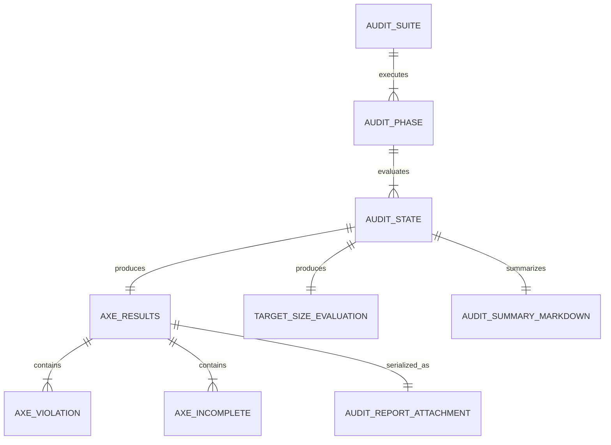
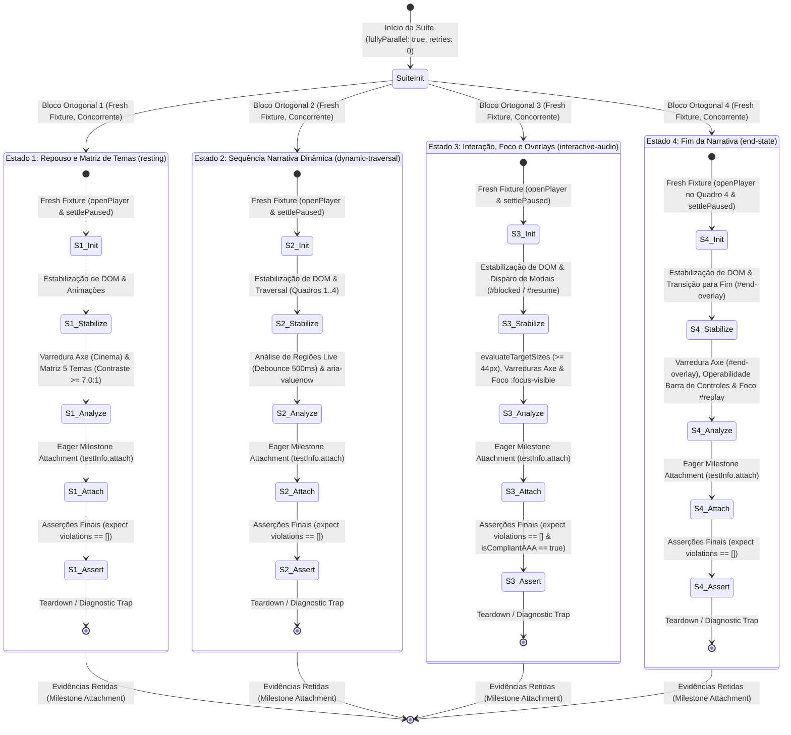

# Data Model: Esteira Automatizada de Auditoria WCAG 2.2 AAA com Axe-Core para Playwright

**Feature Directory**: `specs/004-wcag-aaa-audit-pipeline`  
**Date**: 2026-10-24  
**Status**: Design (Phase 1)

---

## 1. Entidades do Domínio de Auditoria



### 1.1 `AuditMetadata` (Cabeçalho de Metadados e Escopo)
Representa a proveniência formal, contexto de execução e delimitação metodológica de cada varredura:

| Campo | Tipo | Descrição | Regras de Validação |
| :--- | :--- | :--- | :--- |
| `engine` | `string` | Nome do motor de auditoria | Fixo: `"@axe-core/playwright"` |
| `engineVersion` | `string` | Versão exata do pacote | Fixo: `"4.13.0"` |
| `playwrightVersion` | `string` | Versão do Playwright | Ex.: `"1.64.0"` |
| `browser` | `string` | Identificador do motor e viewport | `"desktop-chromium"` ou `"mobile-chromium"` |
| `viewport` | `object` | Dimensões computadas do viewport | `{ width: number, height: number }` (ex: 1280×720 ou 360×800) |
| `timestamp` | `string` | Carimbo de data/hora ISO 8601 | Formato UTC válido (`YYYY-MM-DDTHH:mm:ss.sssZ`) |
| `classification` | `string` | Enquadramento metodológico | Fixo: `"Machine-Verifiable Automated Regression Gate"` |
| `targetStandard` | `string` | Norma internacional de referência | Fixo: `"W3C WCAG 2.2 (Automated Subset)"` |
| `tags` | `string[]` | Tags normativas ativadas no Axe | `['wcag2a', 'wcag2aa', 'wcag21a', 'wcag21aa', 'wcag22aa', 'wcag2aaa']` |
| `assertor` | `object` | Metadados do assertor (padrão W3C EARL) | `{ type: "earl:Software", name: string, operator: "CI/CD Pipeline" }` |
| `disclaimer` | `string` | Ressalva formal de escopo manual | Declaração de que o teste não substitui avaliação humana |

---

### 1.2 `AxeViolation` e `AxeIncomplete`
Modelam os diagnósticos emitidos pelo motor Axe-Core durante a execução do método `analyze()`:

```typescript
interface AxeViolation {
  id: string;               // Ex: "color-contrast-enhanced", "button-name"
  impact: 'minor' | 'moderate' | 'serious' | 'critical';
  description: string;      // Descrição sumária da regra
  help: string;             // Orientação concisa de remediação
  helpUrl: string;          // URI normativa da Deque University
  tags: string[];           // Ex: ['wcag2aaa', 'wcag146', 'cat.color']
  nodes: AxeNodeResult[];   // Nós do DOM que violaram a regra
  truncated?: boolean;      // True se o array nodes foi truncado para cumprir o teto de payload (P3/P4)
  totalNodes?: number;      // Contagem total de nós violadores antes da truncagem (P3/P4)
}

interface AxeIncomplete {
  id: string;               // Ex: "color-contrast" ou "color-contrast-enhanced"
  impact?: 'minor' | 'moderate' | 'serious' | 'critical' | null;
  description: string;      // Descrição sumária da verificação
  help?: string;            // Orientação concisa de inspeção ou remediação
  helpUrl?: string;         // URI normativa da Deque University
  tags?: string[];          // Ex: ['wcag2aaa', 'wcag146']
  nodes: AxeNodeResult[];   // Nós inconclusivos (ex: sobreposição de gradientes ou imagens)
  truncated?: boolean;      // True se o array nodes foi truncado para cumprir o teto de payload (P3)
  totalNodes?: number;      // Contagem total de nós inconclusivos antes da truncagem (P3)
}
```

**Regras de Validação no Portão**:
- `violations.length === 0`: **Mandatório (Fail-Fast)**. Qualquer violação confirmada quebra o teste (`expect(results.violations).toEqual([])`).
- `incomplete.length >= 0`: **Warn-Only**. Diagnósticos inconclusivos não quebram o teste, mas são emitidos em `console.table` e registrados no anexo.

---

### 1.3 `AxeNodeResult` e `AxeCheckResult` (Estruturas de Nós do Axe-Core)
Modelam os nós do DOM e os resultados das verificações individuais emitidas pelo Axe-Core:

```typescript
interface AxeNodeResult {
  target: string[];         // Seletores CSS do elemento (ex: ["#frame-description"])
  html: string;             // Snippet do elemento HTML renderizado
  failureSummary?: string;  // Explicação técnica do motivo da falha (obrigatório em nós de violations; opcional em incomplete conforme schema)
  any?: AxeCheckResult[];   // Árvores brutas de checagem do Axe-Core (removidas via check-tree stripping no relatório)
  all?: AxeCheckResult[];   // Árvores brutas de checagem do Axe-Core (removidas via check-tree stripping no relatório)
  none?: AxeCheckResult[];  // Árvores brutas de checagem do Axe-Core (removidas via check-tree stripping no relatório)
}

interface AxeCheckResult {
  id: string;               // Identificador da verificação (ex: "color-contrast")
  impact?: string | null;   // Impacto opcional da verificação individual
  message: string;          // Mensagem explicativa
  data?: unknown;           // Dados computados da regra (ex: { fgColor, bgColor, contrastRatio })
  relatedNodes?: Array<{
    target: string[];
    html: string;
  }>;
}
```

**Check-Tree Stripping e Teto Orçamentário ($\le 50\text{ KB}$)**:
Em runtime, o método `axe.run()` ou `AxeBuilder.analyze()` retorna instâncias de nós contendo árvores recursivas de checagem profunda (`any`, `all`, `none`). Para cumprir estritamente o teto orçamentário de payload ($\le 50\text{ KB}$ por anexo JSON definido em `contracts/audit-report.schema.json`), o helper de auditoria aplica **check-tree stripping**: descarta os arrays de checagens internas (`any`, `all`, `none`) e serializa nos nós de `violations` e `incomplete` apenas as propriedades canônicas essenciais (`target`, `html` e `failureSummary`), mantendo o relatório limpo, sem bloat e 100% aderente ao esquema contratual.

**Truncamento Determinístico de Nós (`MAX_NODES_PER_RULE = 10`) para Violações e Incompletos (Finding P3)**:
Para prevenir estouro do orçamento de payload do anexo ($\le 50\text{ KB}$) em cenários de teste de estresse, falhas em massa ou diagnósticos inconclusivos volumosos, define-se explicitamente a constante `MAX_NODES_PER_RULE = 10` (aplicável tanto como `MAX_NODES_PER_VIOLATION = 10` quanto `MAX_NODES_PER_INCOMPLETE = 10`). O truncamento aplica-se com estrita consistência e simetria a ambas as categorias de diagnósticos (`violations` e `incomplete`): se uma regra ou verificação apresentar mais de 10 nós afetados (`nodes.length > MAX_NODES_PER_RULE`) durante fuzz testing, execuções de alto volume ou avaliações complexas de DOM, o serializador retém apenas os primeiros 10 nós (`nodes.slice(0, 10)`) e atribui os campos opcionais `truncated: true` e `totalNodes: nodes.length` no respectivo objeto de diagnóstico (`AxeViolation` ou `AxeIncomplete`). Caso contrário (`nodes.length <= MAX_NODES_PER_RULE`), as propriedades `truncated` e `totalNodes` permanecem omitidas (`undefined`), assegurando que tanto violações confirmadas quanto diagnósticos inconclusivos respeitem idênticas garantias orçamentárias sem inflar a carga útil JSON.

---

### 1.4 `TargetSizeEvaluation` (Avaliação Híbrida de Alvos de Toque)
Modela a aferição em dois níveis para garantir áreas de toque acessíveis. A função auxiliar `evaluateTargetSizes` produz este modelo de avaliação em memória para viabilizar o padrão de **Anexação Antecipada (*Eager Milestone Attachment*)** antes do lançamento de qualquer asserção, perfeitamente alinhado a `contracts/audit-report.schema.json`:

```typescript
interface TargetSizeEvaluation {
  tested: boolean;
  status: 'pass' | 'fail';
  tier1Status: 'pass' | 'fail' | 'not-applicable'; // WCAG 2.2 AA SC 2.5.8 (piso 24px do Axe-Core)
  tier2Status: 'pass' | 'fail' | 'not-applicable'; // WCAG 2.2 AAA SC 2.5.5 (44x44px programático)
  compliantCount: number;
  nonCompliantCount: number;
  smallestTarget: {
    id: string;
    width: number;
    height: number;
  } | null;                                        // Menor alvo de toque mensurado, ou null se não aplicável
  controls: TargetSizeControl[];
  isCompliantAAA: boolean;                         // true se todos os controles elegíveis possuem width >= (44 - EPSILON) e height >= (44 - EPSILON), com tolerância determinística EPSILON = 0.05
}

interface TargetSizeControl {
  selector: string;                                // Seletor CSS do elemento (ex: "#play-pause", "button[aria-label='...']")
  id?: string;                                     // Identificador ou rótulo textual legível
  width: number;                                   // Largura computada (deve ser >= 44 - EPSILON para conformidade AAA, onde EPSILON = 0.05)
  height: number;                                  // Altura computada (deve ser >= 44 - EPSILON para conformidade AAA, onde EPSILON = 0.05)
  isCompliant: boolean;                            // width >= (44 - EPSILON) && height >= (44 - EPSILON) && withinViewport (EPSILON = 0.05)
  box: {
    x: number;
    y: number;
    width: number;
    height: number;
  };
}
```

**Regras de Validação e Ciclo Eager Attachment**:
- `evaluateTargetSizes` produz o modelo `TargetSizeEvaluation` de forma desacoplada das asserções, permitindo que os dados completos de alvos táteis sejam anexados via `testInfo.attach()` antes que asserções `expect(...)` possam interromper o teste.
- **Predicado de Elegibilidade e Descarte de Inertes (P3)**: Todos os controles elegíveis que satisfaçam o predicado de elegibilidade devem ter `isCompliantAAA === true`. Elementos que correspondam a `[inert]` ou que estejam contidos em qualquer ancestral inerte (`el.matches('[inert]') || el.closest('[inert]')`), elementos contidos em `[aria-hidden="true"]` ou `[hidden]`, elementos ocultos (`display === 'none'`, `visibility !== 'visible'`, `opacity === 0`), controles desabilitados (`disabled` ou `aria-disabled="true"`) ou com `pointer-events: none` são **estritamente descartados da avaliação de alvos de toque**. Especificamente, quando `#player.inert = true` durante a exibição dos overlays modais (`#blocked-overlay` ou `#resume-overlay`), todos os botões e controles internos ao player são ignorados pela avaliação geométrica, prevenindo falsas violações sobre elementos temporariamente inoperáveis.
- Aplicação de tolerância explícita de ponto flutuante `EPSILON = 0.05` para mitigar discrepâncias de subpixel rendering na comparação contra 44px (AAA) e 24px (AA).
- Elementos com exceção normativa comprovada (links inline em parágrafos) são isentos de SC 2.5.5.
- A medição deve ser executada após estabilização de animações finitas (filtrando `iterations !== Infinity` via `Promise.all(animations.map(a => a.finished))` com fallback de timeout de segurança de 500ms via `Promise.race`) no estado de repouso sem microinterações de `:active`.
- Em estados onde alvos de toque não são aplicáveis, `tested` assume `false`, `status` assume `'pass'`, `tier1Status` e `tier2Status` assumem `'not-applicable'`, `compliantCount` e `nonCompliantCount` assumem `0`, `smallestTarget` assume `null`, `controls` assume `[]` e `isCompliantAAA` assume `true`.

---

### 1.5 `AuditReportAttachment`
Pacote serializado em JSON anexado ao Playwright via `testInfo.attach('axe-audit-<theme>-<state>.json', ...)` com teto de $\le 50\text{ KB}$, validado contra `contracts/audit-report.schema.json`:

```typescript
interface AuditReportAttachment {
  metadata: AuditMetadata;
  theme: 'cinema' | 'noir' | 'eldritch' | 'industrial' | 'shadow-props';
  state: 'resting' | 'dynamic-traversal' | 'interactive-audio' | 'end-state';
  metrics: {
    passesCount: number;          // Escalar apenas (evita report bloat)
    violationsCount: number;
    incompleteCount: number;
    inapplicableCount: number;    // Escalar apenas
    durationMs: number;
  };
  violations: AxeViolation[];     // Detalhado apenas em violações
  incomplete: AxeIncomplete[];   // Sanitizado
  targetSizeSummary: TargetSizeEvaluation;
}
```

---

### 1.6 `AuditSummaryMarkdown`
Relatório sumário executivo em formato Markdown gerado pela função `formatAuditSummaryMarkdown` e anexado via `testInfo.attach('audit-summary-<theme>-<state>.md', ...)` com teto de $\le 10\text{ KB}$, contendo tabelas concisas de regras validadas, violações (zero no portão de aprovação), diagnósticos inconclusivos e tempos de execução conforme especificado em `contracts/test-suite-api.md`.

---

### 1.7 `AuditFailureTelemetry`
Estrutura do payload capturado pelo gancho `test.afterEach` em `<state>-failure-telemetry.json` em caso de falha intermediária ou status inesperado do teste, rigorosamente alinhado ao esquema formal Draft 2020-12 em `contracts/failure-telemetry.schema.json`:

```typescript
interface AuditFailureTelemetry {
  timestamp: string;               // ISO 8601 UTC (format: date-time)
  theme: 'cinema' | 'noir' | 'eldritch' | 'industrial' | 'shadow-props'; // Tema ativo no momento da falha
  state: 'resting' | 'dynamic-traversal' | 'interactive-audio' | 'end-state'; // Estado do teste no momento da falha
  url: string;                     // URL corrente da página
  playerState?: {
    currentFrameIndex?: number;    // integer >= 0
    totalFrames?: number;          // integer >= 0
    isPlaying?: boolean;
    isPaused?: boolean;
    audioActive?: boolean;
    inert?: boolean;
  };
  domState: {
    activeElementSelector: string; // Seletor CSS ou identificador do elemento focado
    modalVisible: boolean;         // Indicador se algum overlay modal está ativo
    overlayId?: string | null;     // ID do overlay visível ('#blocked-overlay' | '#resume-overlay' | '#end-overlay' | null)
  };
}
```

**Regras de Validação no Portão**:
- `timestamp`, `theme`, `state`, `url` e `domState` são campos obrigatórios conforme `contracts/failure-telemetry.schema.json`.
- `playerState` é opcional, capturado defensivamente caso o player esteja inicializado.
- `domState.activeElementSelector` e `domState.modalVisible` são obrigatórios em `domState`.

---

## 2. Fluxo de Dados e Estados de Auditoria



### Regras de Transição e Ciclo de Vida por Estado:

#### Distinção Crítica entre Jornada Narrativa e Execução dos Testes E2E (Finding P7)
É imperativo distinguir formalmente a modelagem conceitual da narrativa cinematográfica da arquitetura técnica de execução dos testes:
- **Jornada Narrativa Conceitual**: Para modelagem artística e de domínio, a experiência do leitor percorre quatro estados em progressão sequencial (Estado 1: Repouso inicial no Quadro 1 $\to$ Estado 2: Traversal dinâmico e avanço narrativo $\to$ Estado 3: Interação com áudio e suspensão de foco em modais $\to$ Estado 4: Encerramento da obra no Quadro final).
- **Execução Ortogonal e Concorrente dos Testes E2E**: Na suíte de testes Playwright (`tests/e2e/accessibility.spec.js`), os 4 blocos de teste são **completamente ortogonais, independentes e executam sob `fullyParallel: true`**. Não há modo serial (`mode: 'serial'`), nem encadeamento temporal, nem reutilização de página ou estado de navegador entre eles. Cada bloco é um teste atômico autônomo que instancia sua própria fixture limpa (*Fresh Fixture* via `openPlayer`), posiciona o player diretamente nas pré-condições do estado a ser auditado e dispara sua análise e anexação de artefatos de forma assíncrona e concorrente.

A suíte abandona qualquer acoplamento monolítico linear em favor de **blocos modulares ortogonais desacoplados**. Cada estado de auditoria (Estados 1 a 4) é executado como um teste independente com isolamento completo de contexto via padrão *Fresh Fixture* e retenção antecipada via *Eager Milestone Attachment*:

1. **Ciclo de Vida Padronizado de Cada Bloco de Teste**:
   - **Inicialização Independente (*Fresh Fixture*)**: Invocada via `beforeEach` (`openPlayer` e `settlePaused`), garantindo um DOM limpo sem efeitos colaterais de testes prévios.
   - **Estabilização de DOM e Animações**: Espera formal de animações pendentes (filtrando animações finitas com `iterations !== Infinity` via `Promise.all(animations.map(a => a.finished))` com fallback de timeout determinístico de 500ms via `Promise.race`) e resolução do debounce de 500ms do `AccessibilityController`.
   - **Execução de Análise**: Varredura Axe-Core (`page` completo com tags WCAG AAA) e avaliação programática (`evaluateTargetSizes`).
   - **Anexação Antecipada (*Eager Milestone Attachment*)**: Chamada imediata de `attachAuditArtifacts(testInfo, ...)` serializando JSON ($\le 50\text{ KB}$) e Markdown ($\le 10\text{ KB}$) antes de qualquer asserção.
   - **Asserções Finais e Teardown**: Execução de `expect(violations).toEqual([])` e validações geométricas; em caso de falha inesperada, o gancho `test.afterEach` captura automaticamente o snapshot DOM, screenshot e telemetria (*Diagnostic Trap*).

2. **Estado 1: Repouso e Matriz de Temas (`resting`)**:
   - Fresh Fixture: `openPlayer(page, 'src/data/story.json', { pause: true })` e `settlePaused(page, 0)`.
   - Guarda: `#frame-description` não-vazio e `data-image-loading === "false"`.
   - Análise: Varredura completa do Quadro 1 canônico (`cinema`) e comutação via seletor `#theme` para os temas `noir`, `eldritch`, `industrial` e `shadow-props`, validando `color-contrast-enhanced` ($\ge 7.0:1$ para texto normal, $\ge 4.5:1$ para texto grande).
   - Eager Attachment: Anexa `axe-audit-<theme>-resting.json` e Markdown correspondente.
   - Asserções: Zero violações confirmadas.

3. **Estado 2: Sequência Narrativa Dinâmica (`dynamic-traversal`)**:
   - Fresh Fixture: Inicialização isolada com o player pausado no quadro inicial.
   - Traversal: Avanço sequencial pelos quadros 1 a 4 via `player.moveTo(i, false)`.
   - Análise: Sincronização de texto de `#frame-description` aguardando resolução de debounce de 500ms do `AccessibilityController`, monotonicidade de `aria-valuenow` (1..4) e atributos `alt` descritivos de imagem.
   - Eager Attachment: Anexa `axe-audit-<theme>-dynamic-traversal.json` e Markdown.
   - Asserções: Zero violações Axe e consistência semântica de live region.

4. **Estado 3: Interação, Foco e Overlays (`interactive-audio`)**:
   - Fresh Fixture: Inicialização isolada no estado de repouso.
   - Disparos:
     - Foco ativo no seletor nativo `#theme` com `:focus-visible` (anel de foco visível $\ge 2\text{px}$ e contraste $\ge 3:1$).
     - Avaliação de alvos táteis via `evaluateTargetSizes(page, 'nav.control-bar, #blocked-overlay:not([hidden])')` produzindo o modelo `TargetSizeEvaluation` com cálculo de `isCompliantAAA` (tolerância estrita `EPSILON = 0.05` e estabilização com fallback timeout de 500ms; descarta controles inertes sob `#player.inert = true`), `tier1Status`, `tier2Status` e `smallestTarget`.
     - Exibição de `#blocked-overlay` como diálogo modal (`role="dialog"`, `aria-modal="true"`, `aria-labelledby="blocked-title"`, `#player.inert = true`, foco retido em `#continue-silent`).
     - Exibição de `#resume-overlay` disparando `player.pauseForFocusLoss()` (exposto via `window.__cinematicPlayer.pauseForFocusLoss()`) em memória, com `role="dialog"`, `aria-modal="true"`, `aria-labelledby="resume-title"`, `#player.inert = true` e foco em `#resume-button`.
     - Validação de `#audio-status` (`role="status"`, `aria-live="polite"`).
   - Eager Attachment: Anexa `axe-audit-<theme>-interactive-audio.json` incorporando `targetSizeSummary` antes das asserções.
   - Asserções: `expect(violations).toEqual([])`, `expect(targetEval.isCompliantAAA).toBe(true)`, integridade modal e focus trap.

5. **Estado 4: Fim da Narrativa (`end-state`)**:
   - Fresh Fixture: Inicialização isolada posicionada no último quadro narrativo.
   - Disparos: Conclusão da história exibindo o diálogo não-modal `#end-overlay` (`role="dialog"` sem `aria-modal`, com `aria-labelledby="end-title"`).
   - Análise: Verificação da barra de controles desobstruída perante SC 2.4.12 e FR-033, foco inicial em `#replay`, navegação por `Tab` desimpedida e restauração de foco em `#player`. Regra de precedência: `#end-overlay` suprime `#resume-overlay` quando o status é `ended`.
   - Eager Attachment: Anexa `axe-audit-<theme>-end-state.json` e Markdown.
   - Asserções: Zero violações Axe e integridade de diálogo não-modal.

---

*Fim do Modelo de Dados.*
