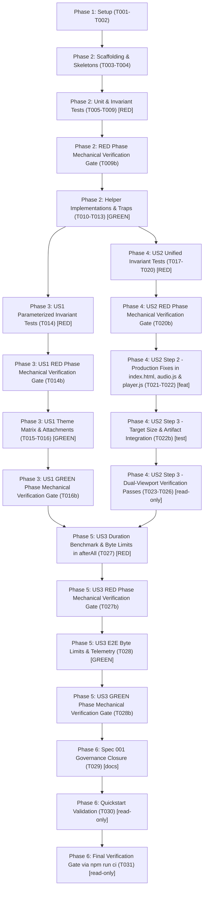

# Tasks: Esteira Automatizada de Auditoria WCAG 2.2 AAA com Axe-Core para Playwright

**Input**: Design documents from `specs/004-wcag-aaa-audit-pipeline/` (`spec.md`, `plan.md`, `research.md`, `data-model.md`, `contracts/test-suite-api.md`, `contracts/audit-report.schema.json`, `quickstart.md`)  
**Prerequisites**: `spec.md` (mandatory), `plan.md` (mandatory), `data-model.md`, `contracts/test-suite-api.md`  
**Constitution**: Aligned with Constitution v2.1.0 (Principles I, II, III, IV, V, VI)  
**Organization**: Tasks are grouped strictly by user story to enable independent implementation, testing, and incremental delivery.  
**Total Tasks**: 39 tasks (Phase 1: 2, Phase 2: 13, Phase 3: 5, Phase 4: 12, Phase 5: 4, Phase 6: 3) | 13 Verification Gates (Read-Only)

## Execution Rules & Governance

0. **Scaffolding & Templates First (Mandate 0)**: All boilerplate, helper skeletons, contracts, schemas, and test fixtures MUST be established before writing hand-crafted business logic.
1. **Strict TDD & Property-Based Invariant Tests (Mandates 1 & 2)**: Unit test tasks for helpers and E2E test tasks MUST be written first, explicitly marked `[RED PHASE - BLOCKING]` implementation tasks until tests are written and verified failing (RED) before implementation. Tests MUST evaluate mathematical, geometric, and structural invariants (e.g. $\ge 7.0:1$ contrast across all theme permutations, $\ge 44 \times 44\text{px}$ bounding boxes across all eligible controls, and byte budgets $\le 50\text{ KB}$) using property-based testing (`fast-check`) where applicable.
2. **Subagent Waves & Disjoint Files [P] (Mandate 3)**: Tasks on disjoint files are marked `[P]` and dispatched in parallel waves. Tasks sharing context or files MUST run sequentially within the same agent session. Concurrency race conditions (such as running test assertions while production files are being edited) are strictly eliminated by staging production changes into preceding sub-waves (e.g., Wave 4 Step 2a before Step 2b).
3. **Objective Verification Gate (Mandate 4)**: Verification tasks at the end (Phase 6) are scheduled strictly at the conclusion of the phase, with `npm run ci` (T031) serving as the ultimate verification gate. ONLY these verification tasks attest to the success and completeness of the implementation. The agent NEVER self-attests completion without green verification output. Spec 001 governance updates (T029) are implemented and committed first in Phase 6, followed by quickstart documentation verification (T030), and concluding with the full CI verification gate (T031), ensuring that only verification tasks attest to the completion of the implementation.
4. **Deterministic Commit Hook & Conventional Scopes (Mandate 5)**: Whenever editing a file finishes, execute an atomic conventional commit with a detailed summary of changes, adhering to the standardized scopes:
   - `chore(deps):` for Phase 1 dependency pinning and preflight toolchain setup
   - `chore(a11y):` for scaffolding helper skeletons, schemas, and test fixtures
   - `test(a11y):` for test scaffolding, unit tests, fast-check property tests, diagnostic failure traps, and invariant test tasks
   - `feat(a11y):` for production implementations (dialog/overlay semantics, inert/focus management) and test helpers (`axe-helper.js`, `target-size-helper.js`, `audit-attachment-helper.js`)
   - `docs(governance):` for Spec 001 governance tracking updates (T029) and quickstart/guide documentation
   - `chore(ci):` for full automated pipeline verification
   Verification tasks (`T002`, `T009b`, `T014b`, `T016b`, `T020b`, `T023`, `T024`, `T025`, `T026`, `T027b`, `T028b`, `T030`, `T031`) are read-only validation commands that verify quality gates without altering codebase files or creating empty git commits.

## Format: `- [ ] [TaskID] [P?] [Story?] Description with file path`

- **[P]**: Can run in parallel (different files, no dependencies)
- **[Story]**: Associated User Story (`[US1]`, `[US2]`, `[US3]`)
- Every task includes explicit file paths, acceptance criteria, invariant specifications, and atomic commit scopes.

---

## Phase 1: Setup (Shared Infrastructure)

**Purpose**: Dependency installation, strict version pinning, and toolchain preflight integrity.

- [X] T001 Pin exact devDependencies `@axe-core/playwright@4.13.0` and `fast-check@3.23.2` without semver ranges (`^` or `~`) in `package.json` devDependencies and update `package-lock.json` via clean install per FR-001, AGENTS.md, and Plan §Technical Context [`chore(deps): pin @axe-core/playwright to 4.13.0 and fast-check to 3.23.2`]
- [X] T002 Verify toolchain preflight integrity by running `npm run preflight`, ensuring all 16 of 16 validation gates pass with zero semver drift per SC-005 and Quickstart §2 [read-only validation gate, no commit]

---

## Phase 2: Foundational (Blocking Prerequisites & Scaffolding)

**Purpose**: Scaffold helper skeletons, schemas, and fixtures (Mandate 0); author unit tests and fast-check property-based tests in RED phase (Mandates 1 & 2); implement modular test helpers (`axe-helper.js`, `target-size-helper.js`, `audit-attachment-helper.js`); and configure Playwright E2E suite skeleton with diagnostic failure traps.

**⚠️ CRITICAL**: Must complete before any user story execution blocks can be instantiated.

### Scaffolding (Mandate 0)

- [X] T003 [P] Scaffold helper skeletons and test fixtures: create stub module files for `tests/e2e/helpers/axe-helper.js` (including stubbed function signatures for `createAxeBuilder`, `formatIncompleteDiagnostics`, and contrast utilities `calculateContrastRatio`, `relativeLuminance`, `meetsContrastEnhanced`), `tests/e2e/helpers/target-size-helper.js` (`evaluateTargetSizes`), and `tests/e2e/helpers/audit-attachment-helper.js` (`attachAuditArtifacts`, `captureFailureArtifacts`); create directory `tests/fixtures/audit/` with explicit fixtures `tests/fixtures/audit/valid-audit-report.json` and `tests/fixtures/audit/invalid-audit-report.json` matching `specs/004-wcag-aaa-audit-pipeline/contracts/audit-report.schema.json`, alongside `tests/fixtures/audit/valid-failure-telemetry.json` and `tests/fixtures/audit/invalid-failure-telemetry.json` matching `specs/004-wcag-aaa-audit-pipeline/contracts/failure-telemetry.schema.json` for unit testing per Mandate 0, Finding H2, FR-012 [`chore(a11y): scaffold helper skeletons and test fixtures`]
- [X] T004 [P] Scaffold test suite skeleton in `tests/e2e/accessibility.spec.js` configuring deterministic execution `test.describe.configure({ retries: 0 })` (omitting `mode: 'serial'` per Finding P1 to guarantee test independence), registering declarative non-Chromium skip `test.skip(({ project }) => !['desktop-chromium', 'mobile-chromium'].includes(project.name))` per ARC-001, Finding P1, FR-002, Contracts §1, §3, and registering 4 independent test blocks for canonical states (Estado 1: Repouso e Matriz de Temas `resting`, Estado 2: Sequência Narrativa Dinâmica `dynamic-traversal`, Estado 3: Interação, Foco e Overlays `interactive-audio`, Estado 4: Fim da Narrativa `end-state`) per Finding P1, FR-002, Contracts §1, §3 [`test(a11y): scaffold E2E accessibility suite skeleton`]

### Unit Tests & Property-Based Invariant Tests (TDD - RED Phase First) ⚠️ (Mandates 1 & 2, Findings T1, S3, A4, T3, A6, T-PBT-1, T-TDD-1)

> **NOTE: Write these tests FIRST, ensure they FAIL before implementation.**

- [X] T005 [P] **[RED PHASE - BLOCKING]** Write schema validation unit tests in `tests/unit/audit-report-schema.test.js` using `import Ajv2020 from 'ajv/dist/2020.js'` (`ajv: 8.20.0`) to compile `specs/004-wcag-aaa-audit-pipeline/contracts/audit-report.schema.json` and `specs/004-wcag-aaa-audit-pipeline/contracts/failure-telemetry.schema.json` (Draft 2020-12) alongside each other, validating against explicit fixtures `tests/fixtures/audit/valid-audit-report.json`, `tests/fixtures/audit/invalid-audit-report.json`, `tests/fixtures/audit/valid-failure-telemetry.json`, and `tests/fixtures/audit/invalid-failure-telemetry.json`, verifying strict rejection of missing required fields, invalid ISO timestamps, unknown properties, and payload excesses, ensuring tests fail (RED) prior to helper implementation per FR-012, Finding S3 & A4, Finding H2, Contracts §6, §6.1.2 [`test(a11y): add audit report and failure telemetry schema ajv unit tests`]
- [X] T006 [P] **[RED PHASE - BLOCKING]** Write unit tests for AxeBuilder factory helper in `tests/unit/axe-helper.test.js` asserting that `createAxeBuilder(page)` applies normative tags `['wcag2a', 'wcag2aa', 'wcag21a', 'wcag21aa', 'wcag22aa', 'wcag2aaa']`, enables rules `target-size` and `color-contrast-enhanced`, maintains full document root scope without restricted `.include()`, and verifies `formatIncompleteDiagnostics(incomplete)` generates formatted tabular log output per Finding T1, FR-003, FR-006, FR-011 [`test(a11y): add axe helper unit tests`]
- [X] T007 [P] **[RED PHASE - BLOCKING]** Write unit tests for target size evaluator in `tests/unit/target-size-helper.test.js` asserting eligibility predicate filtering (rejection of hidden, disabled, or pointer-events: none controls), bounding box calculation logic ($\ge 44 \times 44\text{px}$), finite animation filtering (`iterations !== Infinity`), and 500ms safety timeout fallback per Finding T1, Finding U3, FR-005, Contracts §5.3 [`test(a11y): add target size evaluator unit tests`]
- [X] T008 [P] **[RED PHASE - BLOCKING]** Write property-based testing (PBT) invariant tests in `tests/unit/target-size-invariants.test.js` using `fast-check` to test geometric and bounding box invariants across arbitrary control dimensions: asserting that any rectangular bounding box with $w \ge 44$ and $h \ge 44$ always yields `isCompliantAAA === true`, and any control with $w < 44$ or $h < 44$ without sufficient spacing yields `isCompliantAAA === false` per Finding T3 & A6, Mandate 2, Finding T-PBT-1, FR-005 [`test(a11y): add target size property-based invariant tests with fast-check`]
- [X] T008b [P] **[RED PHASE - BLOCKING]** Write property-based contrast ratio invariant unit tests in `tests/unit/contrast-invariants.test.js` using `fast-check` to test mathematical contrast ratio invariants across arbitrary RGB color permutations: asserting that relative luminance monotonicity holds, contrast ratio calculations satisfy symmetry ($CR(c_1, c_2) = CR(c_2, c_1)$), ratio values remain strictly bounded within $[1.0, 21.0]$, and threshold predicates for normal text ($\ge 7.0:1$) and large text ($\ge 4.5:1$) correctly evaluate compliance per Mandate 2, Finding M6, Finding T-PBT-1, FR-004, FR-010 [`test(a11y): add contrast ratio property-based invariant tests with fast-check`]
- [X] T009 [P] **[RED PHASE - BLOCKING]** Write unit tests for audit attachment helper in `tests/unit/audit-attachment-helper.test.js` testing payload serialization, attachment formatting, markdown summary generation ($\le 10\text{ KB}$), and property-based tests with `fast-check` for parser round-tripping ($JSON.parse \circ JSON.stringify$), Markdown structural invariants (table schemas and section headers $\le 10\text{ KB}$), and payload truncation ($\le 50\text{ KB}$) across arbitrary violation volumes stripping raw `passes` and `inapplicable` nodes per Finding T1, Finding M6, FR-012, Contracts §6 [`test(a11y): add audit attachment helper unit tests`]
- [X] T009b **[RED PHASE - MECHANICAL GATE]** Mechanically verify and log that all 6 unit tests fail (RED PHASE) before implementation begins by running `node --test tests/unit/audit-report-schema.test.js tests/unit/axe-helper.test.js tests/unit/target-size-helper.test.js tests/unit/target-size-invariants.test.js tests/unit/contrast-invariants.test.js tests/unit/audit-attachment-helper.test.js` per Mandate 1, Finding T-TDD-1, GOV-001 [read-only validation gate, no commit]

### Implementation for Phase 2 Helpers (GREEN Phase)

- [X] T010 [P] Implement AxeBuilder factory helper `createAxeBuilder(page)`, tabular logger `formatIncompleteDiagnostics(incomplete)`, and mathematical contrast calculation utilities (`calculateContrastRatio`, `relativeLuminance`, `meetsContrastEnhanced`) in `tests/e2e/helpers/axe-helper.js` satisfying unit test T006 and property-based test T008b (dependent on T006, T008b, and T009b), configuring normative tags `['wcag2a', 'wcag2aa', 'wcag21a', 'wcag21aa', 'wcag22aa', 'wcag2aaa']`, rules `target-size` and `color-contrast-enhanced`, full document root scope without `.include()` restrictions, tabular console warnings, and canonical WCAG 2.2 sRGB luminance linearization / contrast ratio calculation within $[1.0, 21.0]$ per FR-003, FR-004, FR-006, FR-010, FR-011, and Contracts §4, §4.1, §5.2 [`feat(a11y): implement axe helper factory, contrast utilities, and diagnostics logger`]
- [X] T011 [P] Implement programmatic target size evaluator helper `evaluateTargetSizes(page, containerSelector = 'body')` in `tests/e2e/helpers/target-size-helper.js` satisfying unit tests T007 & T008, targeting selector `button, select, input:not([type="hidden"]), textarea, a[href], summary, [role="button"], [role="link"], [role="slider"], [role="combobox"]` with selector deduplication (`new Set`), eligibility predicate rejecting `closest('[aria-hidden="true"], [hidden], [inert]')`, `el.inert`, `display: none`, `visibility !== 'visible'`, `opacity === 0`, `disabled`, `aria-disabled="true"`, or `pointerEvents: 'none'`, stabilizing animations with `document.getAnimations()` filtering specifically for finite animations (`iterations !== Infinity`) with defensive animation `.catch()` rejection handling (`a.finished.catch(() => {})`) and a 500ms safety timeout fallback, and returning a structured `TargetSizeEvaluation` object with `isCompliantAAA`, `tier1Status`, `tier2Status`, `smallestTarget`, `controls`, and `nonCompliantCount` without throwing assertion exceptions, enabling eager attachment of `targetSizeSummary` prior to assertion failure per Finding U3, FR-005, FR-009, Contracts §5.3, and Data-Model §1.2 [`feat(a11y): implement target size evaluator helper`]
- [X] T012 [P] Implement eager evidence retention helper `attachAuditArtifacts(testInfo, results, theme, state, targetSizeSummary = null)` in `tests/e2e/helpers/audit-attachment-helper.js` satisfying unit test T009, establishing base JSON/Markdown serialization, integrating root-level `targetSizeSummary` metadata, appending formal annotation `audit_scope`, and fully implementing payload byte-capping ($\le 50\text{ KB}$ JSON, $\le 10\text{ KB}$ Markdown) and node stripping (raw `passes` and `inapplicable` node arrays) so that T009 turns green in Phase 2 per Finding T-DEP-1, FR-012, Contracts §6, and Data-Model §1.1 [`feat(a11y): implement audit attachment helper with payload byte-capping and node stripping`]
- [X] T013 Implement diagnostic failure trap in `tests/e2e/accessibility.spec.js` registering `test.afterEach` capturing failure DOM snapshot (`<state>-failure-dom.html`), screen screenshot (`<state>-failure-screenshot.png`), and player telemetry (`<state>-failure-telemetry.json`) adhering strictly to `specs/004-wcag-aaa-audit-pipeline/contracts/failure-telemetry.schema.json`, inspecting active DOM focus, overlay presence, audio status from `#audio-toggle[aria-pressed]`, and frame progress from `#progress[aria-valuenow]` with defensive `try...catch` against browser crashes / TargetClosedError upon test failure per Finding H2, FR-012, Contracts §6, §6.1.2 [`test(a11y): implement diagnostic failure trap in afterEach compliant with failure telemetry schema`]

**Checkpoint**: Foundation, test fixtures, unit tests, and modular helpers ready — user story TDD phases can now proceed.

---

## Phase 3: User Story 1 - Garantia Contínua de Acessibilidade Visual e Contraste AAA (Priority: P1) 🎯 MVP

**Goal**: Deliver continuous automated mathematical proof that all 5 visual themes (`cinema`, `noir`, `eldritch`, `industrial`, `shadow-props`) comply with WCAG 2.2 AAA SC 1.4.6 (`color-contrast-enhanced`) requiring $\ge 7.0:1$ for normal text ($<24\text{px}$ or $<18.66\text{px}$ bold), $\ge 4.5:1$ for large text ($\ge 24\text{px}$ or $\ge 18.66\text{px}$ bold), text-node button Unicode glyphs $\ge 7.0:1$, and zero structural violations in resting state (Estado 1: Repouso e Matriz de Temas `resting`).

**Independent Test**: `npx playwright test tests/e2e/accessibility.spec.js --project=desktop-chromium -g "Estado 1"`

### Tests for User Story 1 (TDD - RED Phase first) ⚠️

> **NOTE: Write these tests FIRST, ensure they FAIL before implementation.**

- [X] T014 [US1] **[RED PHASE - BLOCKING]** Write parameterized Playwright E2E invariant test for Estado 1: Repouso e Matriz de Temas (`resting`) contrast audit in `tests/e2e/accessibility.spec.js` cycling through all 5 themes (`cinema`, `noir`, `eldritch`, `industrial`, `shadow-props`) on Frame 1, asserting the mathematical invariant that every text node satisfies contrast ratio $\ge 7.0:1$ (normal text) or $\ge 4.5:1$ (large text), Unicode glyph buttons satisfy $\ge 7.0:1$, and Axe violations array is strictly empty (`results.violations === []`), verifying the test fails (RED) before state stabilization implementation per Finding T-PBT-1, FR-003, FR-004, FR-008.1, FR-010, SC-001, SC-002 [`test(a11y): add State 1 theme contrast invariant test`]
- [X] T014b [US1] **[RED PHASE - MECHANICAL GATE]** Mechanically verify and log that the Estado 1 Theme Matrix contrast test fails (RED) on unprocessed themes before DOM stabilization and theme cycling logic via `npx playwright test tests/e2e/accessibility.spec.js --project=desktop-chromium -g "Estado 1"` per Mandate 1, GOV-001 [read-only validation gate, no commit]

### Implementation for User Story 1

- [X] T015 [US1] Implement DOM stabilization logic and theme cycling execution in `tests/e2e/accessibility.spec.js` for Estado 1: Repouso e Matriz de Temas (`resting`) awaiting `data-image-loading="false"` and settled paused status (`data-status="paused"`) before triggering `createAxeBuilder(page).analyze()` per FR-007, FR-008.1, Data-Model §2, and Contracts §4 [`test(a11y): implement State 1 DOM stabilization and theme cycling`]
- [X] T016 [US1] Integrate eager attachment in `tests/e2e/accessibility.spec.js` for Estado 1: Repouso e Matriz de Temas (`resting`) generating canonical `axe-audit-<theme>-resting.json` and `audit-summary-<theme>-resting.md` before assertions per FR-008.1, FR-012, and Contracts §6 [`test(a11y): integrate eager artifact attachment in State 1`]
- [X] T016b [US1] **[GREEN PHASE - MECHANICAL GATE]** Mechanically verify that Estado 1 passes (GREEN phase) on desktop-chromium via `npx playwright test tests/e2e/accessibility.spec.js --project=desktop-chromium -g "Estado 1"` [read-only validation gate, no commit]

**Checkpoint**: User Story 1 MVP fully functional and independently testable on `desktop-chromium` (mechanically verified passing via validation gate T016b).

---

## Phase 4: User Story 2 - Integridade de Estados Interativos e Alvos de Toque (Priority: P2)

**Goal**: Certify ARIA semantic integrity and physical target dimensions $\ge 44 \times 44\text{px}$ (WCAG 2.2 AAA SC 2.5.5) across interactive and dynamic states (Estado 2: Sequência Narrativa Dinâmica `dynamic-traversal` across frames 1 to 4 with live region debounce; Estado 3: Interação, Foco e Overlays `interactive-audio` with focused controls, native `<select id="theme">`, modal `#blocked-overlay` with focus trap, `#resume-overlay`, `#audio-status`; Estado 4: Fim da Narrativa `end-state` with non-modal `#end-overlay` and unobstructed control bar).

**Independent Test**: `npx playwright test tests/e2e/accessibility.spec.js --project=desktop-chromium --project=mobile-chromium -g "Estado 2|Estado 3|Estado 4"`

### Tests for User Story 2 (TDD - RED Phase first) ⚠️

> **NOTE: Write these tests FIRST, ensure they FAIL before implementation.**

- [X] T017 [US2] **[RED PHASE - BLOCKING]** Write Estado 2: Sequência Narrativa Dinâmica (`dynamic-traversal`) invariant tests in `tests/e2e/accessibility.spec.js` unifying test authoring, auto-waiting on narrative description changes, frame progression traversal across frames 1 to 4, ARIA invariants (`aria-valuenow` monotonically increasing '1'..'4', `#frame-image` descriptive `alt`, 500ms debounced live region `#frame-description` matching story narration), eager attachment generation (`axe-audit-<theme>-dynamic-traversal.json`), and zero Axe violations per Finding T-TDD-2, FR-008.2, FR-012 [`test(a11y): add State 2 narrative traversal invariant tests`]
- [X] T018 [US2] **[RED PHASE - BLOCKING]** Write Estado 3: Interação, Foco e Overlays (`interactive-audio`) invariant tests in `tests/e2e/accessibility.spec.js` unifying test authoring, overlay dispatchers (`#blocked-overlay` autoplay simulation via `page.addInitScript`, `#resume-overlay` via `window.__cinematicPlayer.pauseForFocusLoss()`), modal focus trap assertions on `#continue-silent` and `#resume-button`, focus ring visibility ($\ge 2\text{px}$, contrast $\ge 3:1$) on active controls (including native closed `<select id="theme">` without synthetic `aria-expanded`), `#player.inert` attribute verification, and `#audio-status` live region (`role="status"`, `aria-live="polite"`) per Finding T-TDD-2, FR-008.3, FR-013, FR-014, Clarification Q9, Q15 [`test(a11y): add State 3 interactive overlay invariant tests`]
- [X] T019 [US2] **[RED PHASE - BLOCKING]** Write Estado 4: Fim da Narrativa (`end-state`) invariant tests in `tests/e2e/accessibility.spec.js` unifying test authoring, non-modal dialog semantics for `#end-overlay` (`role="dialog"` strictly without `aria-modal`), accessible name assertion (`aria-labelledby="end-title"`), initial focus on `#replay`, natural Tab traversal into unobstructed `nav.control-bar`, asserting the overlay precedence suppression rule (where `#end-overlay` takes absolute precedence and suppresses `#resume-overlay` when status is `ended` per FR-014), and focus return to `#player` upon replay trigger per Finding T-TDD-2, FR-008.4, FR-014, FR-033, and SC 2.4.12 [`test(a11y): add State 4 narrative conclusion invariant tests`]
- [X] T020 [US2] **[RED PHASE - BLOCKING]** Author all target size invariant test assertions in `tests/e2e/accessibility.spec.js` invoking `evaluateTargetSizes` across all eligible interactive controls in `nav.control-bar`, `#blocked-overlay`, and `#end-overlay` across defined states (Estado 1: Repouso e Matriz de Temas `resting`, Estado 3: Interação, Foco e Overlays `interactive-audio`, and Estado 4: Fim da Narrativa `end-state`) and viewports (`mobile-chromium` $360 \times 800$ and `desktop-chromium` $1280 \times 720$), asserting `expect(evaluation.isCompliantAAA).toBe(true)` ($\ge 44 \times 44\text{px}$, SC 2.5.5 AAA) to establish a genuine RED baseline at T020b prior to production fixes and artifact wiring per Finding F02 / U7, Finding M4, Finding T-PBT-1, FR-005, SC-003, Contracts §5.3 [`test(a11y): add target size invariant test assertions for States 1, 3, and 4`]

### Implementation for User Story 2

- [X] T020b [US2] **[RED PHASE - MECHANICAL GATE]** Run `npx playwright test tests/e2e/accessibility.spec.js` to verify controlled failure (RED) establishing a genuine RED baseline across both target size assertions and missing dialog semantics in `index.html` and inert/focus shielding in `audio.js`/`player.js` per Finding M4, GOV-001 [read-only validation gate, no commit]

#### Step 2: Production Semantics & Keyboard Shielding Fixes [P] (Findings F01/P2, F02/U7, Mandate 3)

> **⚠️ CRITICAL**: Production fixes on `index.html`, `src/scripts/audio.js`, and `src/scripts/player.js` must be implemented and committed in Step 2 BEFORE test execution in Step 3 to eliminate concurrency race conditions.

- [X] T021 [P] [US2] Implement dialog and overlay accessibility semantics and accessible names in `index.html` adding `role="dialog"`, `aria-modal="true"`, and accessible names (`aria-labelledby="blocked-title"`, `aria-labelledby="resume-title"`) to `#blocked-overlay` and `#resume-overlay`, and non-modal `role="dialog"` (strictly omitting `aria-modal`) with accessible name `aria-labelledby="end-title"` to `#end-overlay` per FR-013, FR-014, and SC 2.4.12 [`feat(a11y): add dialog, modal semantics, and accessible names to overlays in index.html`]
- [X] T022 [P] [US2] Implement focus and keyboard shielding in `src/scripts/audio.js`, `src/scripts/player.js`, and `src/scripts/main.js` applying `#player.inert = true` when `#blocked-overlay` or `#resume-overlay` is displayed, restoring `#player.inert = false` and focus to `#player` upon dismiss/continue/resume, maintaining internal Tab focus trap on `#continue-silent` and `#resume-button`, exposing `window.__cinematicPlayer` in `src/scripts/main.js` / `src/scripts/player.js`, implementing public test harness method `pauseForFocusLoss()` in `src/scripts/player.js`, and implementing the overlay precedence suppression rule in `src/scripts/player.js` (where `#end-overlay` takes absolute precedence and suppresses `#resume-overlay` when status is `ended` per FR-014) per FR-013, FR-014 [`feat(a11y): implement focus trap, inert shielding, window.__cinematicPlayer, and overlay precedence in audio.js and player.js`]

#### Step 3: Test Execution & Verification (Findings T-TDD-2, T-COMMIT-2, T-DEP-2, M3, M4)

- [X] T022b [US2] Wire returned target size evaluations into eager artifact attachments across States 1, 3, and 4 in `tests/e2e/accessibility.spec.js`, strictly wiring the returned `TargetSizeEvaluation` into `attachAuditArtifacts(testInfo, results, theme, state, evaluation)` without altering test logic or adding assertions (which were established in T020) per Finding M3, Finding M4, Finding T-DEP-2, FR-005, SC-003, Contracts §5.3, §6 [`test(a11y): wire target size evaluations into eager audit attachments across States 1, 3, 4`]
- [X] T023 [US2] Execute Estado 2: Sequência Narrativa Dinâmica (`dynamic-traversal`) test pass and verify live region synchronization and frame progression across desktop and mobile viewports in `tests/e2e/accessibility.spec.js` per FR-008.1, FR-008.2, FR-012 via `npx playwright test tests/e2e/accessibility.spec.js --project=desktop-chromium --project=mobile-chromium -g "Estado 2"` [read-only validation gate, no commit]
- [X] T024 [US2] Execute Estado 3: Interação, Foco e Overlays (`interactive-audio`) test pass and verify overlay dispatchers, modal focus traps, inert shielding, and touch target sizes across desktop and mobile viewports in `tests/e2e/accessibility.spec.js` per FR-008.1, FR-008.3, Clarification Q9, Q15 via `npx playwright test tests/e2e/accessibility.spec.js --project=desktop-chromium --project=mobile-chromium -g "Estado 3"` [read-only validation gate, no commit]
- [X] T025 [US2] Execute Estado 4: Fim da Narrativa (`end-state`) test pass and verify end-of-story overlay non-modal navigation flow, replay trigger, overlay precedence suppression, focus restoration to `#player`, and touch target sizes across desktop and mobile viewports in `tests/e2e/accessibility.spec.js` per FR-008.1, FR-008.4, FR-014 via `npx playwright test tests/e2e/accessibility.spec.js --project=desktop-chromium --project=mobile-chromium -g "Estado 4"` [read-only validation gate, no commit]
- [X] T026 [US1] Mechanically verify that Estado 1 passes (GREEN phase) via `npx playwright test tests/e2e/accessibility.spec.js --project=desktop-chromium -g "Estado 1"` [read-only validation gate, no commit]

**Checkpoint**: User Stories 1 and 2 independently verified across desktop and mobile viewports with zero race conditions.

---

## Phase 5: User Story 3 - Blindagem Automatizada no Pipeline de CI (Priority: P3)

**Goal**: Integrate the accessibility audit into `npm run test:e2e` and `npm run ci` with deterministic single-pass runtime $\le 10.0\text{s}$ (SC-004), 16/16 preflight integrity (SC-005), eager evidence retention, and formal governance alignment closing the automated leg of tasks T144, T159, and T176 in Spec 001.

**Independent Test**: `npm run preflight && npm run test:e2e`

### Tests for User Story 3 (TDD - RED Phase first) ⚠️

> **NOTE: Write these tests FIRST, ensure they FAIL before implementation.**

- [X] T027 [US3] **[RED PHASE - BLOCKING]** Author execution duration benchmark logic ($\le 10.0\text{s}$) and artifact byte size ceiling assertions ($\le 50\text{ KB}$ JSON, $\le 10\text{ KB}$ Markdown) in `test.afterAll` in `tests/e2e/accessibility.spec.js`, recording execution duration benchmark into `metrics.durationMs` across audit artifacts and asserting compliance with the $\le 10.0\text{s}$ execution budget per SC-004 and byte ceilings per SC-006 and FR-012, eliminating brittle in-test `expect(duration).toBeLessThan` assertions and the `--workers=1` CI constraint. To preserve the canonical 4-test structure (`4 passed`) documented in quickstart.md without introducing spurious standalone test cases, author both duration benchmark and byte limit assertions in `test.afterAll` ensuring a controlled RED baseline per Finding C1 & H1, Finding F07, Finding T01 / P1, SC-004, SC-006 [`test(a11y): author duration benchmark and artifact byte limit assertions in afterAll`]
- [X] T027b [US3] **[RED PHASE - MECHANICAL GATE]** Mechanically verify red baseline before assertions and reporting are finalized via `npx playwright test tests/e2e/accessibility.spec.js --project=desktop-chromium -g "Estado 1"` per Mandate 1, GOV-001 [read-only validation gate, no commit]

### Implementation for User Story 3

- [X] T028 [US3] Implement and verify artifact byte limits ($\le 50\text{ KB}$ JSON, $\le 10\text{ KB}$ Markdown) and structural integrity in `test.afterAll` in `tests/e2e/accessibility.spec.js` without `Ajv2020` schema compilation (which remains strictly isolated in Node unit test T005) per Finding T01 / P1, Finding D2, Finding T-DEP-1, FR-012, SC-006, Contracts §5.5, §6, Plan §Technical Context [`feat(a11y): implement artifact byte limits and structural integrity verification in afterAll`]
- [X] T028b [US3] **[GREEN PHASE - MECHANICAL GATE]** Mechanically verify that all US3 assertions pass green via `npx playwright test tests/e2e/accessibility.spec.js --project=desktop-chromium` [read-only validation gate, no commit]

**Checkpoint**: All three user stories integrated and safeguarded against regression.

---

## Phase 6: Polish & Verification Gate (Mandate 4)

**Purpose**: Update Spec 001 governance tracking, execute independent toolchain verification, and run the full regression suite. T029 runs and commits first, followed by quickstart validation (T030), and concluding with T031 (`npm run ci`) as the final verification gate. ONLY these verification commands attest to the success and completeness of the implementation, never the agent itself (Rule 4).

- [X] T029 [US3] Update governance records in `specs/001-cinematic-player/tasks.md` marking the automated verification leg of tasks T144, T159, and T176 as complete while retaining explicit notes that real screen-reader and human usability testing remain open manual scope per Finding T03, Mandate 4, Finding D2, SC-006, Research §3, Clarification Q6 [`docs(governance): update Spec 001 tasks T144, T159, T176 automated audit status`]
- [X] T030 Verify documentation and executable commands in `specs/004-wcag-aaa-audit-pipeline/quickstart.md` ensuring all CLI instructions execute green per quickstart.md. Runs non-interactive CLI scenarios (1, 2, 4) and checks artifact existence in `playwright-report/` for Scenario 3 without starting an interactive server. Note: T030 must run sequentially BEFORE T031 to avoid port 8080 collision (`EADDRINUSE`) and test-result directory corruption in Playwright per Finding T-VERIF-1, Finding T-COMMIT-1 [read-only validation gate, no commit]
- [X] T031 Execute deterministic full verification gate via `npm run ci` confirming 16/16 preflight checks, manifest validation, unit tests, image builds, production bundle, Playwright E2E matrix, and performance test budgets pass with zero regressions across existing test files (`wcag-audit.spec.js`, `contrast.spec.js`, `theme-a11y.spec.js`, `reduced-motion.spec.js`) and green status across all accessibility audit states per Mandate 4, Finding D3, Finding T-COMMIT-1 [read-only validation gate, no commit]

---

## Dependencies & Execution Order

### Phase Dependencies

- **Setup (Phase 1)**: No dependencies — executes first.
- **Foundational (Phase 2)**: Depends on Phase 1 completion — blocks all user stories. Scaffolds skeletons and fixtures, enforces unit and invariant tests in RED phase, and implements modular helpers.
- **User Story 1 (Phase 3 - P1)**: Depends on Phase 2 completion. Delivers MVP contrast audit and mechanical GREEN verification gate T016b.
- **User Story 2 (Phase 4 - P2)**: Depends on Phase 2 completion. Production fixes (Step 2) precede test execution and dual-viewport verification (Step 3).
- **User Story 3 (Phase 5 - P3)**: Depends on Phase 3 and Phase 4 completion. Validates pipeline performance and artifact byte ceilings in `test.afterAll`, enforces mechanical RED gate T027b, implements E2E artifact byte limits and structural integrity without Ajv2020 compilation in E2E (T028), and verifies green status via mechanical gate T028b.
- **Polish & Verification Gate (Phase 6)**: Depends on completion of all user story phases. Spec 001 governance tracking records (T029) are updated and committed first, followed by non-interactive quickstart scenarios (T030), concluding with the full verification gate `npm run ci` (T031) attesting to final implementation completeness per Mandate 4.

### User Story Completion Order



---

## Parallel Opportunities & Subagent Wave Execution Plan

```text
Wave 1 (Setup & Preflight):
  └── T001 (package.json) -> T002 (npm run preflight) [Sequential: shared toolchain lock; T002 is read-only validation]

Wave 2 (Foundational Scaffolding, Unit Tests & Helpers):
  ├── Step 1 [SCAFFOLD - Mandate 0]:
  │   ├── Agent A: T003 (helper skeletons in tests/e2e/helpers/ including contrast calculations & fixtures tests/fixtures/audit/valid-audit-report.json, tests/fixtures/audit/invalid-audit-report.json, tests/fixtures/audit/valid-failure-telemetry.json, tests/fixtures/audit/invalid-failure-telemetry.json) [P]
  │   └── Agent B: T004 (tests/e2e/accessibility.spec.js scaffold without mode: 'serial') [P]
  ├── Step 2 [RED - Unit & Property-Based Invariant Tests - Mandates 1 & 2]:
  │   ├── Agent A: T005 (tests/unit/audit-report-schema.test.js with Ajv2020 validating audit-report and failure-telemetry schemas against fixtures) [P]
  │   ├── Agent B: T006 (tests/unit/axe-helper.test.js) [P]
  │   ├── Agent C: T007 (tests/unit/target-size-helper.test.js) [P]
  │   ├── Agent D: T008 (tests/unit/target-size-invariants.test.js with fast-check) [P]
  │   ├── Agent E: T008b (tests/unit/contrast-invariants.test.js with fast-check) [P]
  │   └── Agent F: T009 (tests/unit/audit-attachment-helper.test.js) [P]
  ├── Step 2.5 [RED VERIFICATION GATE - Mechanical Validation]:
  │   └── T009b (Run node --test to verify all 6 unit tests fail in RED phase per GOV-001) [Mandate 1, Finding T-TDD-1]
  └── Step 3 [GREEN - Implementations & Traps]:
      ├── Agent A: T010 (implement axe-helper.js with createAxeBuilder, formatIncompleteDiagnostics, and contrast utilities calculateContrastRatio, relativeLuminance, meetsContrastEnhanced satisfying T006 and T008b; depends on T006, T008b, T009b) [P]
      ├── Agent B: T011 (implement target-size-helper.js with [inert] handling, animation .catch() rejection handling, selector deduplication, and 500ms timeout) [P]
      ├── Agent C: T012 (implement audit-attachment-helper.js with byte capping and node stripping) [P]
      └── Followed by: T013 (diagnostic failure trap in accessibility.spec.js afterEach adhering to failure-telemetry.schema.json, inspecting #audio-toggle[aria-pressed] and #progress[aria-valuenow])

Wave 3 (User Story 1 - TDD MVP):
  ├── Step 1 [RED]: T014 (failing Estado 1: Repouso e Matriz de Temas theme contrast parameterized test in accessibility.spec.js)
  ├── Step 1.5 [RED VERIFICATION GATE - Mechanical Validation]: T014b (Run npx playwright test tests/e2e/accessibility.spec.js --project=desktop-chromium -g "Estado 1" to verify controlled RED failure on unprocessed themes per GOV-001) [read-only validation gate, no commit]
  ├── Step 2 [GREEN]: T015, T016 (DOM stabilization & eager attachments in accessibility.spec.js for Estado 1)
  └── Step 2.5 [GREEN VERIFICATION GATE - Mechanical Validation]: T016b (Run npx playwright test tests/e2e/accessibility.spec.js --project=desktop-chromium -g "Estado 1" to mechanically verify Estado 1 passes in GREEN phase) [read-only validation gate, no commit]

Wave 4 (User Story 2 - TDD & Disjoint Production Fixes):
  ├── Step 1 [RED - Unified Test Authoring]: T017, T018, T019, T020 (failing invariant tests in accessibility.spec.js for Estados 2, 3, 4)
  ├── Step 1.5 [RED VERIFICATION GATE - Mechanical Validation]: T020b (Run npx playwright test tests/e2e/accessibility.spec.js to verify controlled RED failure on missing semantics/shielding per GOV-001) [read-only validation gate, no commit]
  ├── Step 2 [GREEN - Production Fixes]: (Prevents concurrency race condition per Mandate 3, Finding F01/P2)
  │   ├── Agent A: T021 (dialog & overlay semantics and aria-labelledby accessible names in index.html) [P]
  │   └── Agent B: T022 (focus/keyboard shielding, window.__cinematicPlayer.pauseForFocusLoss(), and overlay precedence in src/scripts/audio.js, src/scripts/player.js, src/scripts/main.js) [P]
  └── Step 3 [GREEN - Test Execution & Invariant Verification]:
      └── Agent C: T022b (wire target size evaluations into eager artifacts across States 1, 3, 4 in accessibility.spec.js) followed by dual-viewport verification passes T023, T024, T025 (--project=desktop-chromium --project=mobile-chromium for Estados 2, 3, 4) and T026 regression pass for Estado 1 (read-only validation gates)

Wave 5 (User Story 3 - CI Budgets & Byte Limits):
  ├── Step 1 [RED]: T027 (author execution duration benchmark <= 10.0s into metrics.durationMs and artifact byte size ceilings in test.afterAll in accessibility.spec.js)
  ├── Step 1.5 [RED VERIFICATION GATE - Mechanical Validation]: T027b (Run npx playwright test tests/e2e/accessibility.spec.js --project=desktop-chromium -g "Estado 1" to verify controlled RED baseline of afterAll assertions per GOV-001) [read-only validation gate, no commit]
  ├── Step 2 [GREEN]: T028 (implement artifact byte limits and structural integrity verification in test.afterAll in accessibility.spec.js)
  └── Step 2.5 [GREEN VERIFICATION GATE - Mechanical Validation]: T028b (Run npx playwright test tests/e2e/accessibility.spec.js --project=desktop-chromium to mechanically verify all US3 assertions pass green) [read-only validation gate, no commit]

Wave 6 (Governance Closure, Quickstart & Final Verification Gate - Sequential):
  ├── Step 1: T029 (Spec 001 governance records in specs/001-cinematic-player/tasks.md committed prior to final validation) [`docs(governance)`]
  ├── Step 2: T030 (quickstart.md non-interactive validation) [read-only validation gate, no commit]
  └── Step 3: T031 (full verification gate via npm run ci as ultimate gate attesting to complete pipeline integrity) [read-only validation gate, no commit]
```

---

## Implementation Strategy

### MVP First (User Story 1 Only)

1. Complete Phase 1: Setup (`@axe-core/playwright@4.13.0` and `fast-check@3.23.2` pinning and preflight).
2. Complete Phase 2: Foundational Scaffolding, Unit Tests, and Helpers (`axe-helper.js` including contrast utilities, `target-size-helper.js`, `audit-attachment-helper.js`, `tests/fixtures/audit/valid-audit-report.json`, `tests/fixtures/audit/invalid-audit-report.json`, `tests/fixtures/audit/valid-failure-telemetry.json`, `tests/fixtures/audit/invalid-failure-telemetry.json`, `fast-check` target size and contrast ratio invariants, mechanical RED verification gate `T009b`).
3. Complete Phase 3: User Story 1 (Write failing parameterized test T014 $\to$ verify mechanical RED gate T014b $\to$ implement T015-T016 $\to$ verify mechanical GREEN gate T016b).
4. **Validate MVP**: Run `npx playwright test tests/e2e/accessibility.spec.js --project=desktop-chromium -g "Estado 1"`.

### Incremental Delivery

1. Setup + Foundation $\rightarrow$ Toolchain ready, 6 unit tests passing in `tests/unit/` (including `fast-check` property tests), and helpers isolated in `tests/e2e/helpers/` with byte capping and node stripping built-in.
2. US1 $\rightarrow$ Zero contrast violations $\ge 7:1$ across 5 themes certified in Estado 1: Repouso e Matriz de Temas (`resting`), mechanically verified passing via T016b (MVP!).
3. US2 $\rightarrow$ Unified test authoring (T020 authoring all target size assertions), mechanical RED verification gate (T020b per GOV-001), production dialog semantics and accessible names (`index.html`), inert shielding, `window.__cinematicPlayer.pauseForFocusLoss()`, and overlay precedence suppression (`audio.js`, `player.js`, `main.js`), followed by wiring target size evaluations into eager artifacts (T022b) and test execution verification passes (T023-T025 across both desktop and mobile viewports, T026 regression pass) verifying narrative progression, live regions, dual asymmetric dialogs, 44px touch targets, and Estado 1 theme contrast without race conditions.
4. US3 $\rightarrow$ Duration benchmark $\le 10.0\text{s}$ recorded in `metrics.durationMs` and byte size ceilings authored in `test.afterAll` (T027), mechanical RED verification gate (T027b via `--project=desktop-chromium -g "Estado 1"`), eager attachments, failure diagnostic traps adhering to failure telemetry schema (T013), canonical 4-test structure preserved via `test.afterAll`, live artifact byte limits and structural integrity implemented (T028), and mechanical GREEN verification gate (T028b).
5. Polish $\rightarrow$ Formal Spec 001 governance closure (T029) committed first, quickstart non-interactive validation (T030), followed by full gate `npm run ci` (T031) as the final verification gate attesting to complete pipeline integrity.


---

## Phase 7: Convergence

**Purpose**: Close contract, schema, property-based test invariant, and E2E behavioral divergences identified during `speckit-converge` across `spec.md`, `plan.md`, `contracts/test-suite-api.md`, `contracts/audit-report.schema.json`, `data-model.md`, and runtime implementations.

### Red Phase (TDD & Property-Based Testing Invariants - BLOCKING) ⚠️
- [X] T032 [P] **[RED PHASE - BLOCKING]** Write property-based invariant tests in `tests/unit/audit-attachment-helper.test.js` using `fast-check` to assert Markdown AST structural invariants (table delimiter balance `|---|`, required normative sections `# Relatório de Auditoria WCAG 2.2 AAA`, and $\le 10\text{ KB}$ ceiling) and serialization fuzzing across arbitrary violations and incomplete arrays per `plan.md:34,98`, `contracts/test-suite-api.md §6.2` (missing)
- [X] T033 [P] **[RED PHASE - BLOCKING]** Write unit tests in `tests/unit/audit-report-schema.test.js` and `tests/unit/audit-attachment-helper.test.js` asserting deterministic node truncation with `MAX_NODES_PER_RULE = 10`, verifying that `truncated: true` and `totalNodes: number` are assigned when nodes exceed 10, verifying preservation of `incomplete` metadata (`impact`, `help`, `helpUrl`, `tags`), and asserting generated payload schema validity against `contracts/audit-report.schema.json` per `data-model.md §1.3`, `contracts/audit-report.schema.json:142-150` (missing)
- [X] T034 [P] **[RED PHASE - BLOCKING]** Write unit tests in `tests/unit/axe-helper.test.js` asserting polymorphic signature of `meetsContrastEnhanced` supporting both `(contrast, isLargeText)` and `(foreground, background, isLargeText)`, and asserting `formatIncompleteDiagnostics` returns an array of projected nodes `Array<{ id, impact, help, target }>` adhering to `contracts/test-suite-api.md §4.1, §5.2` (contradicts)
- [X] T035 [P] **[RED PHASE - BLOCKING]** Write unit tests in `tests/unit/target-size-helper.test.js` verifying that `[tabindex="0"]` in interactive overlays is included in target size evaluation and bounding box null checks fail cleanly per FR-005, Contracts §5.3 (missing)
- [X] T036 [P] **[RED PHASE - BLOCKING]** Author failing E2E tests in `tests/e2e/accessibility.spec.js` asserting exact `story.json` alt and description matching on frame progression via `#next-frame` user click in Estado 2, modal semantics, `#resume-overlay` Axe scan and live audio status text in Estado 3, and focus restoration to `#player` with non-overlapping bounding boxes in Estado 4 per FR-006, FR-008.2, FR-008.3, FR-008.4 (partial)

### Green Phase (Implementation & Contract Harmonization)
- [X] T037 [P] Implement `MAX_NODES_PER_RULE = 10`, deterministic node truncation with `truncated: true` and `totalNodes`, and preserve `incomplete` metadata (`impact`, `help`, `helpUrl`, `tags`) in `tests/e2e/helpers/audit-attachment-helper.js` per `data-model.md §1.3`, `contracts/audit-report.schema.json` (partial)
- [X] T038 [P] Implement and export `formatAuditSummaryMarkdown` in `tests/e2e/helpers/audit-attachment-helper.js` satisfying the 4 normative sections of `contracts/test-suite-api.md §6.2`, and update `tests/e2e/accessibility.spec.js` artifact body assertions to accept normative report header per `contracts/test-suite-api.md §6.2`, `data-model.md §1.6` (missing)
- [X] T039 [P] Implement polymorphic signature in `meetsContrastEnhanced`, harmonize `formatIncompleteDiagnostics` to return projected node array, and include `[tabindex="0"]` in target-size helper selector in `tests/e2e/helpers/axe-helper.js` and `tests/e2e/helpers/target-size-helper.js` per `contracts/test-suite-api.md §4.1, §5.2`, FR-005 (contradicts)
- [X] T040 [P] Implement clean event listener lifecycle (removing tab trap listeners on dismiss, destroy, and Escape) in `src/scripts/audio.js` and `src/scripts/player.js` per FR-014 (partial)
- [X] T041 [P] Implement user-click frame progression via `#next-frame`, exact `story.json` text assertions, `#resume-overlay` AxeBuilder scan and live audio status text in Estado 3, replay focus restoration and non-overlapping bounding box verification in Estado 4, and canonical root-level `test.skip` in `tests/e2e/accessibility.spec.js` per ARC-001, FR-006, FR-008.2, FR-008.3, FR-008.4 (partial)

### Verification Gate (Mandate 4)
- [X] T042 Execute verification gate running `npm run test:unit` confirming all unit and property-based invariant tests pass, and `npx playwright test tests/e2e/accessibility.spec.js --project=desktop-chromium --project=mobile-chromium` confirming 8/8 E2E accessibility audit tests pass green with compliant artifacts per Mandate 4 (partial)


---

## Phase 8: Convergence

**Purpose**: Close contract divergences, touch target size evaluations, and test harness completeness identified during `speckit-converge` across `tests/e2e/helpers/axe-helper.js` (`calculateContrastRatio`/`relativeLuminance` string/array support per `contracts/test-suite-api.md §4.1`), `tests/e2e/accessibility.spec.js` (harmonizing `createAxeBuilder` across all 5 themes in Estado 1 per `FR-003`, `SC-001`; adding `#resume-overlay` target size evaluation in Estado 3 per `FR-005`, `FR-008.3`; verifying `#end-overlay` canonical precedence suppressing `#resume-overlay` in Estado 4 per `FR-008.4`, `FR-014`; and asserting `stage.dataset.transition` in Estado 2 per `FR-008.2`).

### Execution & Subagent Wave Plan (Mandates 0, 1, 2, 3, 5)
- **Wave 1 (Red Phase - Blocking TDD & PBT)**:
  - Agent A: T043 (property-based invariant tests in `tests/unit/axe-helper.test.js` & `tests/unit/contrast-invariants.test.js` using `fast-check` asserting hex/rgb string and array parsing in `calculateContrastRatio` and `relativeLuminance`) [P]
  - Agent B: T044 (author failing test assertions in `tests/e2e/accessibility.spec.js` for `#resume-overlay` target size in Estado 3, `#end-overlay` canonical precedence suppression in Estado 4, and transition dataset in Estado 2) [P]
  - Mechanical Gate: T045 (Run tests to verify controlled RED baseline failure before implementation)
- **Wave 2 (Green Phase - Disjoint Implementations)**:
  - Agent C: T046 (implement color parsing in `tests/e2e/helpers/axe-helper.js`) [P]
  - Agent D: T047 & T048 (harmonize 5-theme `createAxeBuilder`, wire target sizes, precedence, and transition in `tests/e2e/accessibility.spec.js`) [P]
- **Wave 3 (Verification Gate - Final Closure)**:
  - T049 (unit and property-based test verification gate)
  - T050 (dual-viewport Playwright accessibility verification gate & preflight)

### Red Phase (TDD & Property-Based Testing Invariants - BLOCKING) ⚠️
- [X] T043 [P] **[RED PHASE - BLOCKING]** Write failing property-based invariant and unit tests in `tests/unit/axe-helper.test.js` and `tests/unit/contrast-invariants.test.js` using `fast-check` asserting that `calculateContrastRatio(fg, bg)` and `relativeLuminance(rgb)` parse arbitrary color strings (hex, rgb(), rgba()) and `[r, g, b]` array tuples without returning `NaN`, adhering to `contracts/test-suite-api.md §4.1` (contradicts)
- [X] T044 [P] **[RED PHASE - BLOCKING]** Author failing E2E test assertions in `tests/e2e/accessibility.spec.js` asserting: (1) `evaluateTargetSizes(page, '#resume-overlay')` in Estado 3 verifying touch target size $\ge 44 \times 44\text{px}$ per FR-005, FR-008.3 (missing); (2) canonical precedence assertion in Estado 4 invoking `pauseForFocusLoss()` and asserting `#resume-overlay` remains hidden per FR-008.4, FR-014 (missing); and (3) `stage.dataset.transition` verification during frame progression in Estado 2 per FR-008.2 (partial)
- [X] T045 **[RED VERIFICATION GATE - Mechanical Validation]** Run `node --test tests/unit/axe-helper.test.js` and `npx playwright test tests/e2e/accessibility.spec.js -g "contrast ratio string parsing|canonical precedence"` to mechanically confirm controlled RED baseline failure before any implementation changes per Mandate 1, GOV-001 (read-only validation gate, no commit)

### Green Phase (Implementation & Contract Harmonization)
- [X] T046 [P] Implement color string and array tuple parsing in `parseColorToRgb`, `relativeLuminance`, and `calculateContrastRatio` in `tests/e2e/helpers/axe-helper.js` ensuring full adherence to `contracts/test-suite-api.md §4.1` per T043 (contradicts)
- [X] T047 [P] Harmonize `tests/e2e/accessibility.spec.js` Estado 1 to execute `createAxeBuilder(page)` with full normative tags and structural rules across all 5 themes (`cinema`, `noir`, `eldritch`, `industrial`, `shadow-props`) per FR-003, SC-001, FR-008.1 (partial)
- [X] T048 [P] Wire `evaluateTargetSizes(page, '#resume-overlay')` into Estado 3, assert `#resume-overlay` suppression on `pauseForFocusLoss()` in Estado 4, and assert `stage.dataset.transition` during traversal in Estado 2 in `tests/e2e/accessibility.spec.js` per T044, FR-005, FR-008.2, FR-008.3, FR-008.4, FR-014 (partial)

### Verification Gate (Mandate 4)
- [X] T049 Execute unit and property-based test verification running `npm run test:unit` verifying all unit and PBT invariant tests pass with zero regressions (read-only validation gate, no commit)
- [X] T050 Execute full dual-viewport Playwright accessibility verification gate running `npx playwright test tests/e2e/accessibility.spec.js --project=desktop-chromium --project=mobile-chromium` and `npm run preflight` mechanically verifying 100% compliance across all 4 canonical states, 5 themes, and CI preflight per SC-001..SC-005, Mandate 4 (read-only validation gate, no commit)


---

## Phase 9: Convergence

**Purpose**: Close narrative traversal coverage divergence identified in `tests/e2e/accessibility.spec.js` Estado 2 where the loop bounds restricted iteration to `story.scenes[0].frames` (2 frames), omitting frames 3 and 4 across the scene boundary and leaving `aria-valuenow` '3' & '4', `alt`, and `description` unverified for the second half of the story per `FR-008.2`, `US2/AC1`, `T017`.

### Execution & Subagent Wave Plan (Mandates 0, 1, 2, 3, 5)
- **Wave 1 (Red Phase - Blocking TDD Invariant Authoring)**:
  - Agent A: T051 (expand frame iteration in `tests/e2e/accessibility.spec.js` Estado 2 across all 4 frames `story.scenes.flatMap(s => s.frames)` asserting `expect(allFrames.length).toBe(4)`, monotonically increasing `aria-valuenow` 1..4, and matching alt/description/transition across scene boundary) [P]
  - Mechanical Gate: T052 (Run `npx playwright test tests/e2e/accessibility.spec.js -g "Estado 2"` to mechanically validate test failure or behavioral bounds under RED baseline before implementation changes)
- **Wave 2 (Green Phase - Disjoint Implementation & Harmonization)**:
  - Agent B: T053 (harmonize narrative traversal in `tests/e2e/accessibility.spec.js` Estado 2 to smoothly step through frames 1 to 4 across scene boundary with auto-waiting on debounce and transition) [P]
- **Wave 3 (Verification Gate - Final Closure)**:
  - T054 (unit and property-based test verification gate)
  - T055 (dual-viewport Playwright accessibility verification gate & preflight)

### Red Phase (TDD & Invariant Gate - BLOCKING) ⚠️
- [X] T051 [P] **[RED PHASE - BLOCKING]** Update frame traversal in `tests/e2e/accessibility.spec.js` Estado 2 to iterate across all 4 story frames via `const allFrames = story.scenes.flatMap((s) => s.frames); expect(allFrames.length).toBe(4);`, asserting sequential user-click frame progression via `#next-frame`, monotonic progression of `aria-valuenow` from '1' to '4', and exact `alt`, `description`, and `data-transition` matching across all 4 frames per FR-008.2, US2/AC1, T017 (partial)
- [X] T052 **[RED VERIFICATION GATE - Mechanical Validation]** Run `npx playwright test tests/e2e/accessibility.spec.js -g "Estado 2"` to mechanically confirm test execution and establish controlled RED baseline before any harmonization changes per Mandate 1, GOV-001 (read-only validation gate, no commit)

### Green Phase (Implementation & Contract Harmonization)
- [X] T053 [P] Harmonize narrative traversal state progression in `tests/e2e/accessibility.spec.js` Estado 2 to smoothly step through frames 1 to 4 across scene boundary (`scene-01` to `scene-02`) with auto-waiting on debounce and transition per T051, FR-008.2 (partial)

### Verification Gate (Mandate 4)
- [X] T054 Execute unit and property-based test verification running `npm run test:unit` verifying all 224 unit and PBT tests pass with zero regressions (read-only validation gate, no commit)
- [X] T055 Execute full dual-viewport Playwright accessibility verification gate running `npx playwright test tests/e2e/accessibility.spec.js --project=desktop-chromium --project=mobile-chromium` and `npm run preflight` mechanically verifying 100% compliance across all 4 canonical states, 5 themes, and CI preflight per SC-001..SC-005, Mandate 4 (read-only validation gate, no commit)
